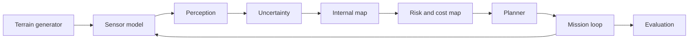

# Automated Planetary Perception System (APPS) — Level 1 Prototype

> **Disclaimer**: This is an independent research prototype using synthetic data. It is not a NASA project, is not affiliated with or endorsed by NASA, is not certified or qualified for flight, and makes no claim about real Mars terrain or driving safety.

---

## 1. Purpose and Central Research Question
APPS is the perception subsystem of Mars Autonomous Intelligence. The research question is:
*Can an uncertainty-aware planetary perception system improve autonomous rover navigation by identifying unfamiliar or potentially hazardous terrain before the navigation planner commits to a route?*

---

## 2. Architecture Overview


The system enforces a strict **Mechanical Information Boundary** (Chapter 91): the rover belief state has zero read access to the simulator ground truth.

---

## 3. Verified Capabilities
1. Procedural synthetic Mars-like terrain generation with difficulty ladder (D0 to D5) and multi-novel materials (N1 to N4).
2. Multi-feature pixel extraction combining visual color/texture and geometric depth gradients.
3. Gradient boosting ensemble classifier providing multi-class logits and predictive entropy.
4. Out-of-distribution (OOD) novelty scoring via Mahalanobis distance in feature space and percentile-based RankGate.
5. Calibrated temperature scaling fitted strictly on validation data to minimize expected calibration error (ECE).
6. Footprint-aware traversability cost map builder with circular disk and Chebyshev obstacle inflation.
7. Multi-criteria A* planner minimizing path length, obstacle risk, uncertainty, and slope energy proxy.
8. Route risk budgeting rejecting routes when cumulative risk proxy $p_{proxy} > p_{budget}$.
9. Closed-loop replanning on obstacle discovery with watchdog monitors (no-progress, replan cap, sensor outage).
10. Independent route verification audit catching illegal jumps and newly blocked cells.
11. Statistical evaluation using cluster bootstrap resampling at the scene level with Wilson score rare-event bounds.
12. Cryptographic archive manifests and pre-registration hash locking.

---

## 4. Installation & Quick Start

### Installation
```bash
pip install -r requirements.txt
```

### Run Full Test Suite
```bash
python -m pytest tests/test_level1.py -v
```

### Run Master Level 1 Pipeline
```bash
python experiments/run_level1.py
```

### Launch Interactive Web Demonstration
```bash
python -m streamlit run app_l1.py
```

---

## 5. Limitations
- **Synthetic Terrain Only**: All models and benchmarks use procedural synthetic data; no claim is made regarding real Mars terrain.
- **Hypothetical Vehicle**: The rover model uses simplified 8-connected grid kinematics without physical wheel-terrain interaction, dynamics, or vehicle sinkage.
- **No Flight Qualification**: Software is an academic research prototype. `navigation_ready` is locked to `False` under `PROTOTYPE_LOCK = True`.

---

## 6. Future Directions (Not Implemented)
- Stereo disparity estimation from rectified optical camera pairs.
- Real Martian navcam transfer studies on NASA AI4MARS archives.
- 3D kinodynamic physics engine integration (Rung 2/3 of simulator ladder).
