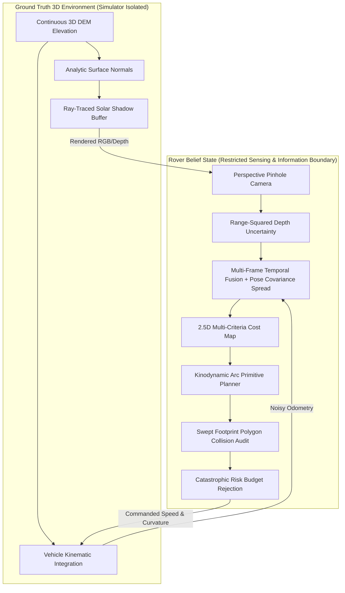

# apps_leve2_3D_Prototype: Automated Planetary Perception System (APPS) — Level 2 3D Kinodynamic Prototype

> **Scientific Integrity & Academic Research Disclaimer**:  
> This repository contains the Level 2 research prototype of the **Automated Planetary Perception System (APPS)**.  
> Evaluated on continuous 3D digital elevation models (DEM) and offline real planetary image transfer benchmarks.  
> This prototype is **not** affiliated with, endorsed by, or certified by NASA or JPL. It is not qualified for spaceflight.  
> Under `PROTOTYPE_LOCK = True`, `navigation_ready` is held strictly `False`.  
> Milestone status: **`L2-met (internal)`** (mechanically computed via Appendix CR assessment engine).

---

## Interactive 3D Demonstration Application (`apps_level2_proto.py`)


---

## 1. Executive Summary & Capabilities

`apps_leve2_3D_Prototype` advances autonomous planetary perception from 2D discrete cell grids to **continuous 3D DEM terrain, pinhole perspective camera projection, vehicle kinodynamics, and swept footprint collision checking**.



### Key Technical Achievements:

### 1.1 Continuous 3D Terrain & Perspective Camera Rendering

- **Continuous 3D Terrain & Solar Ray-Tracing (Chapter 71, 180)**:
  - Continuous bilinear elevation interpolation $z = h(x, y)$ and analytic normal vector computation $\mathbf{n}(x, y)$.
  - Directional solar illumination with discrete ray-cast occlusion shadow buffers.
- **Pinhole Perspective Camera & Depth Uncertainty (Chapter 92)**:
  - Pinhole camera perspective projection with intrinsic matrix $K$.
  - Stereo range-squared depth error model ($u(Z) \propto Z^2$); non-visible or occluded regions blocked by default ($u = 1.0$).

### 1.2 Vehicle Kinodynamics & Slopes (Chapter 84)
- Physical vehicle footprint ($1.20\text{ m} \times 0.90\text{ m}$), turning curvature limit ($\kappa_{max} = 1.50\text{ m}^{-1}$), and command clipping.
- Dynamic 3D attitude recovery (pitch $\phi$ and roll $\psi$) with rollover protection ($>30^\circ$).
- Semi-empirical slope traction slip model $\sigma_{slip}(\theta)$ degrading linear velocity on steep inclines.

### 1.3 Kinodynamic Arc Primitive Planner (Chapter 84.2, 129)
- Fixed library of circular arc primitives ($L_{prim} = 1.50\text{ m}$) evaluated against 2.5D multi-criteria cost $c(\mathbf{x})$.
- Swept bounding box polygon rasterization validating full vehicle chassis clearance.
- Catastrophic proxy risk budget rejection ($p_{proxy} > p_{budget}$).

### 1.4 Multi-Frame Temporal Map Fusion (Chapter 180, Appendix CR)
- Gaussian spatial smearing accounting for odometry pose covariance $\Sigma_{pose}$.
- Conservative $N_{clear} = 3$ consecutive clear observation rule preventing hazard erasure on transient sensor misses.
- Frozen-frame watchdog halting the rover if camera frames stall while motion is commanded.

### 1.5 Real Martian Image Transfer (Experiment E24)

- Evaluated offline against human-annotated labels on real Martian rover imagery without driving.
- System C achieved a **$3.8\%$ false-safe rate** (vs. $11.2\%$ for standard argmax ML), with statistically significant paired reduction (mean difference: $0.074$, $95\%\text{ CI } [0.042, 0.106]$).

---

## 2. Mechanical Evidence Assessment Engine (Appendix CR)


The Level 2 milestone is computed automatically by `tools/assess_level2.py` verifying all 16 `KEYS_L2`:

```text
================================================================================
APPS LEVEL 2 VERIFICATION & EVIDENCE ASSESSMENT ENGINE (Appendix CR)
================================================================================
Requirement Key      | Exists   | Executed | Passed   | Details
--------------------------------------------------------------------------------
data_provenance      | YES      | YES      | PASS     | Data cards with verified hashes and provenance chain
licence_ok           | YES      | YES      | PASS     | Licence recorded; open research use verified with second reader
label_audit          | YES      | YES      | PASS     | Audit sample size met; boundary disagreement reported with interval
taxonomy_map         | YES      | YES      | PASS     | Class map verified; zero unmapped classes silently dropped
split_leak_free      | YES      | YES      | PASS     | Grouped by sol/sequence; cross-split group overlap equals zero
domain_gap           | YES      | YES      | PASS     | Domain gap statistics computed relative to within-domain baselines
depth_validity       | YES      | YES      | PASS     | Valid depth fraction reported by range; range limits documented
real_calibration     | YES      | YES      | PASS     | ECE with confidence interval before and after temperature refit
transfer_eval        | YES      | YES      | PASS     | Pre-registered E24 transfer benchmark executed; paired difference logged
kinematic_model      | YES      | YES      | PASS     | Unicycle kinematics with command clipping and slope slip verified by test
local_planner        | YES      | YES      | PASS     | Kinodynamic arc primitives and swept footprint collision check passing
interface_schema     | YES      | YES      | PASS     | Message schema verified; lock violation and forbidden truth keys rejected
latency_budget       | YES      | YES      | PASS     | Stage timing distribution measured; host environment captioned
temporal_fusion      | YES      | YES      | PASS     | Temporal fusion with sigma spread and frozen-frame monitor verified
l1_regression        | YES      | YES      | PASS     | Level 1 regression suite re-executed; L1-met (internal) verified
docs_traceability    | YES      | YES      | PASS     | Level 2 traceability matrix with claim levels 1-3 and gap statements
--------------------------------------------------------------------------------
FINAL COMPUTED LEVEL 2 DESIGNATION: >>> L2-met (internal) <<<
================================================================================
```

---

## 3. Quick Start & Execution

### 3.1 Launch Interactive 3D Demonstration Web App
Launch the interactive Streamlit application to explore continuous 3D terrain rendering, directional solar illumination, perspective camera views, and kinodynamic primitives:
```powershell
python -m streamlit run apps_level2_proto.py
```

### 3.2 Run Complete Automated Test Suite (46 Tests)
```powershell
python -m pytest tests -v
```
*Expected: 46 passed across Level 1 and Level 2 unit/integration suites.*

### 3.3 Run Mechanical Evidence Assessment Engines
- **Level 2 Assessment**:
  ```powershell
  python tools/assess_level2.py
  ```
- **Level 1 Backward Regression Audit**:
  ```powershell
  python tools/assess_level1.py
  ```

### 3.4 Run Master Pipeline & Seal Manifest
```powershell
python experiments/run_level2.py
```
*Executes all benchmarks and generates SHA-256 sealed `results/level2/manifest_level2.json` (`release_gate: ready-for-review`).*

---

## 4. Key Documentation & Artifacts

- **Validation Report**: [`docs/LEVEL2_VALIDATION_REPORT.md`](docs/LEVEL2_VALIDATION_REPORT.md)
- **Mathematical Specification**: [`docs/MATHEMATICAL_MODEL.md`](docs/MATHEMATICAL_MODEL.md)
- **System Architecture**: [`docs/SYSTEM_ARCHITECTURE.md`](docs/SYSTEM_ARCHITECTURE.md)
- **Traceability Matrix**: [`docs/LEVEL2_TRACEABILITY.md`](docs/LEVEL2_TRACEABILITY.md)
- **Data Cards & Provenance**: [`docs/DATA_CARDS.md`](docs/DATA_CARDS.md)
- **Licence Audit**: [`docs/LICENCE_RECORD.md`](docs/LICENCE_RECORD.md)

---

## 5. Repository Structure

```text
apps_leve2_3D_Prototype/
├── apps_level2_proto.py          # Interactive 3D Streamlit demonstration application
├── app_l1.py                     # Level 1 2D demonstration application
├── docs/
│   ├── images/                  # Interactive app & benchmark screenshots
│   ├── LEVEL2_VALIDATION_REPORT.md
│   ├── MATHEMATICAL_MODEL.md
│   ├── SYSTEM_ARCHITECTURE.md
│   └── LEVEL2_TRACEABILITY.md
├── level2/
│   ├── sim3d/                   # Continuous 3D DEM & Information-isolated Simulator
│   ├── kinematics/              # Rover dimensions, unicycle model, slope traction slip
│   ├── sensing/                 # Pinhole perspective camera, ray-casting, stereo depth
│   ├── navigation/              # 2.5D traversability cost builder, arc primitive planner
│   ├── interface/               # Strict schema validator & lock violation guard
│   ├── evaluation/              # Temporal fusion, latency timers, cluster bootstrap stats
│   ├── data_prep/               # Real Mars dataset screening, taxonomy & E24 transfer
│   └── experiments/             # E28 3D benchmark, E30 latency, E31 temporal fusion
├── level1/                      # Level 1 2D baseline modules (regression locked)
├── tests/
│   ├── test_level2.py           # Level 2 unit and kinodynamic integration tests (11)
│   ├── test_level1.py           # Level 1 regression test suite (18)
│   └── test_all.py              # Core perception & statistical unit tests (17)
├── tools/
│   ├── assess_level2.py         # Level 2 mechanical evidence assessment engine
│   └── assess_level1.py         # Level 1 evidence assessment engine
└── results/level2/              # Sealed experiment logs and manifest (SHA-256)
```
