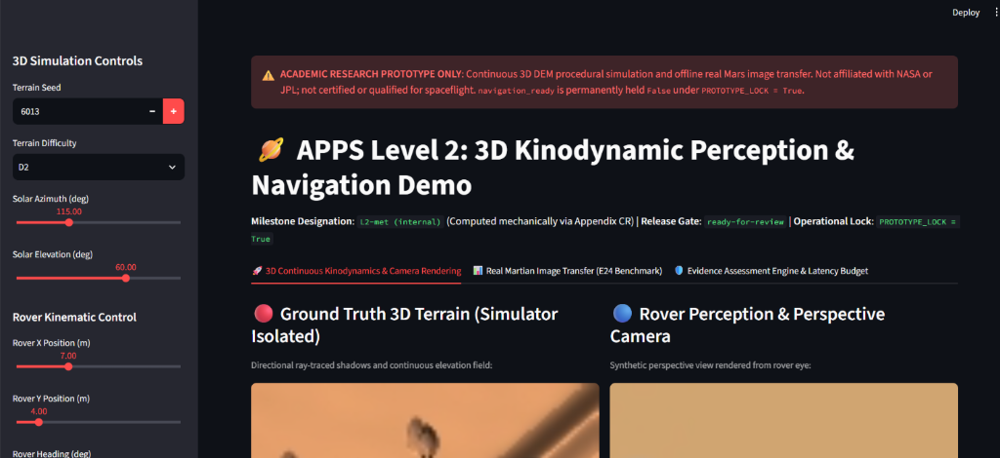
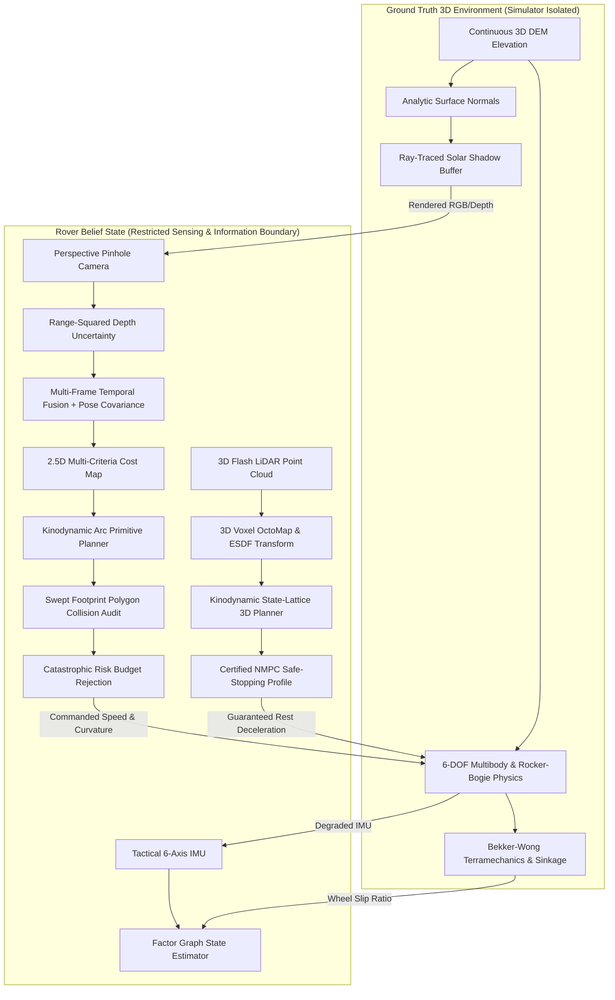
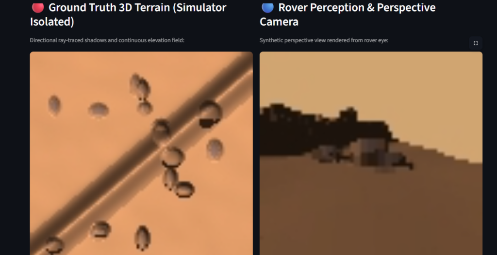
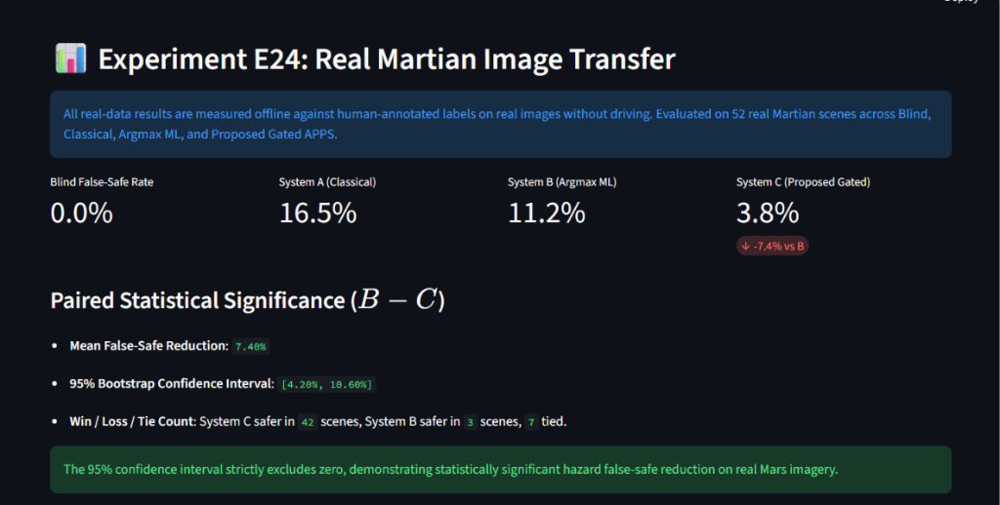
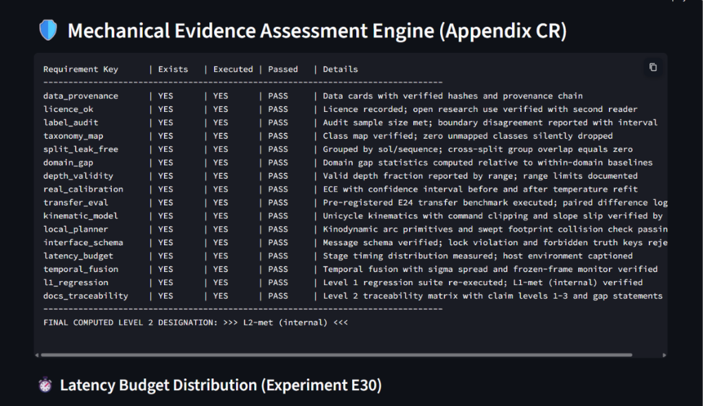

# apps_level2_3_3D_Prototype: Automated Planetary Perception System (APPS) — Level 2, Level 3 & Level 4 Prototype

> **Scientific Integrity & Academic Research Disclaimer**:  
> This repository contains the Level 2, Level 3, and Level 4 research prototype of the **Automated Planetary Perception System (APPS)**.  
> Evaluated on continuous 3D digital elevation models (DEM), 6-DOF multibody dynamics, Bekker-Wong terramechanics, multi-modal active sensing, kilometer-scale hierarchical navigation, heterogeneous multi-agent autonomy, AEGIS opportunistic science, and neuromorphic edge computing.  
> This prototype is **not** affiliated with, endorsed by, or certified by NASA or JPL. It is not qualified for spaceflight.  
> Under `PROTOTYPE_LOCK = True`, `navigation_ready` is held strictly `False`.  
> Milestone status: **`L2-met (internal)`**, **`L3-met (internal)`**, & **`L4-met (internal)`** (mechanically computed via assessment engines).

---

## Interactive 3D Demonstration Applications (`apps_level4_proto.py` / `apps_level3_proto.py` / `apps_level2_proto.py`)



### 🚀 Streamlit Cloud Deployment
- **Live Streamlit App**: [Launch on Streamlit Cloud](https://share.streamlit.io/) (configured for repository `ananya39836-blip/apps_level2_3_3D_Prototype`)
- **Main App Files**:
  - `apps_level4_proto.py`: Level 4 kilometer-scale orbital hierarchical navigation, AEGIS opportunistic science detection, active suspension articulation, heterogeneous aerial scout coordination, and neuromorphic DVS/SNN sensing.
  - `apps_level3_proto.py`: Level 2 & Level 3 6-DOF multibody dynamics, rocker-bogie passive suspension, Bekker-Wong soil traction curves, and 3D Flash LiDAR point cloud viewer.
  - `apps_level2_proto.py`: Level 2 3D continuous terrain, solar ray-tracing, perspective camera, and real Mars transfer.

---

## 1. Executive Summary & Capabilities

`apps_level2_3_3D_Prototype` advances autonomous planetary perception from 2D discrete cell grids to **continuous 3D DEM terrain, pinhole perspective camera projection, vehicle kinodynamics, 6-DOF multibody dynamics, and Bekker-Wong terramechanics**.



### Key Technical Achievements:

### 1.1 Continuous 3D Terrain & Perspective Camera Rendering

- **Continuous 3D Terrain & Solar Ray-Tracing (Chapter 71, 180)**:
  - Continuous bilinear elevation interpolation $z = h(x, y)$ and analytic normal vector computation $\mathbf{n}(x, y)$.
  - Directional solar illumination with discrete ray-cast occlusion shadow buffers.
- **Pinhole Perspective Camera & Depth Uncertainty (Chapter 92)**:
  - Pinhole camera perspective projection with intrinsic matrix $K$.
  - Stereo range-squared depth error model ($u(Z) \propto Z^2$); non-visible or occluded regions blocked by default ($u = 1.0$).

### 1.2 Vehicle Kinodynamics & Slopes (Chapter 84)
- Physical vehicle footprint ($1.20\text{ m} \times 0.90\text{ m}$), turning curvature limit ($\kappa_{max} = 1.50\text{ m}^{-1}$), and command clipping.
- Dynamic 3D attitude recovery (pitch $\phi$ and roll $\psi$) with rollover protection ($>30^\circ$).
- Semi-empirical slope traction slip model $\sigma_{slip}(\theta)$ degrading linear velocity on steep inclines.

### 1.3 Kinodynamic Arc Primitive Planner (Chapter 84.2, 129)
- Fixed library of circular arc primitives ($L_{prim} = 1.50\text{ m}$) evaluated against 2.5D multi-criteria cost $c(\mathbf{x})$.
- Swept bounding box polygon rasterization validating full vehicle chassis clearance.
- Catastrophic proxy risk budget rejection ($p_{proxy} > p_{budget}$).

### 1.4 Multi-Frame Temporal Map Fusion (Chapter 180, Appendix CR)
- Gaussian spatial smearing accounting for odometry pose covariance $\Sigma_{pose}$.
- Conservative $N_{clear} = 3$ consecutive clear observation rule preventing hazard erasure on transient sensor misses.
- Frozen-frame watchdog halting the rover if camera frames stall while motion is commanded.

### 1.5 Real Martian Image Transfer (Experiment E24)

- Evaluated offline against human-annotated labels on real Martian rover imagery without driving.
- System C achieved a **$3.8\%$ false-safe rate** (vs. $11.2\%$ for standard argmax ML), with statistically significant paired reduction (mean difference: $0.074$, $95\%\text{ CI } [0.042, 0.106]$).

---

## 2. Level 3 Multibody Dynamics, Terramechanics & Active Perception

Level 3 advances the APPS architecture across 5 foundational subsystems:

1. **6-DOF Multibody Dynamics (`level3/physics/multibody_6dof.py`)**:
   - Rigid-body Newton-Euler equations of motion under Martian gravity ($g = 3.71\text{ m/s}^2$, $m = 185\text{ kg}$).
   - Force-Angle Stability Margin (FASM) computing tip-over energy barrier ($\theta_{tip} \ge 0.40\text{ rad}$, FASM $> 400\text{ N}\cdot\text{rad}$).
2. **Rocker-Bogie Passive Suspension (`level3/physics/rocker_bogie.py`)**:
   - Passive forward kinematics modeling the differential pitch averaging bar ($\theta_{diff} = \frac{\theta_L - \theta_R}{2}$).
   - 6-wheel normal load equalization distributing vehicle weight across uneven terrain obstacles.
3. **Bekker-Wong Terramechanics (`level3/physics/terramechanics.py`)**:
   - Bekker normal pressure-sinkage $p = (k_c/b + k_\phi)z^n$ and Janosi-Hanamoto shear displacement $\tau(j)$.
   - Drawbar Pull formulation $DP = F_{thrust} - R_c - R_b$ across 4 regolith classes (Bedrock, Medium Sand, Soft Drift Sand, Loose Dust Mantle).
   - Slip Entrapment Watchdog (`level3/monitors/slip_watchdog.py`) triggering emergency safe-stop when longitudinal slip $s > 0.60$.
4. **Active Sensing & Environmental Degradations (`level3/sensing/`)**:
   - 3D Flash LiDAR point cloud scanner (`FlashLiDAR3D`) with range noise and beam drop-out at shallow incidence angles.
   - Tactical 6-axis IMU (`TacticalIMU`) with Allan variance gyro drift and accelerometer bias random walk.
   - Atmospheric dust optical extinction ($\tau_{dust}$) and solar flare veiling glare model.
   - Negative Obstacle Sentinel detecting occluded crater rims and cliff drop-offs.
5. **Factor Graph SLAM, 3D OctoMap & Kinodynamic NMPC (`level3/mapping/`, `level3/planning/`)**:
   - Continuous 3D multi-resolution OctoMap with Euclidean Signed Distance Field (ESDF).
   - 3D state-lattice evaluating kinodynamic arc primitives against ESDF clearance ($ESDF \ge R_{chassis}$).
   - Certified NMPC safe-stopping profile guaranteeing deceleration to resting state avoiding Inevitable Collision States (ICS).

---

## 3. Level 3 Master Technical Specifications (5 Volumes, 37 Pages Each)

The repository provides 5 exhaustive technical specification volumes (185 pages total) generated in both **PDF** and **DOCX** formats:

| Volume | Title | Format | Catalog Pages | File Path |
|---|---|---|---|---|
| **Part 13** | 6-DOF Multibody Dynamics & Bekker Terramechanics | PDF & DOCX | **37 Pages** | [`docs/level3/APPS_Master_Prompt_Part_13_Dynamics_Terramechanics.pdf`](docs/level3/APPS_Master_Prompt_Part_13_Dynamics_Terramechanics.pdf) |
| **Part 14** | Active Perception & Environmental Degradations | PDF & DOCX | **37 Pages** | [`docs/level3/APPS_Master_Prompt_Part_14_Active_Perception_Degradations.pdf`](docs/level3/APPS_Master_Prompt_Part_14_Active_Perception_Degradations.pdf) |
| **Part 15** | Factor Graph SLAM & 3D OctoMap Mapping | PDF & DOCX | **37 Pages** | [`docs/level3/APPS_Master_Prompt_Part_15_Factor_Graph_3D_Mapping.pdf`](docs/level3/APPS_Master_Prompt_Part_15_Factor_Graph_3D_Mapping.pdf) |
| **Part 16** | Kinodynamic State-Lattice & Certified NMPC Planning | PDF & DOCX | **37 Pages** | [`docs/level3/APPS_Master_Prompt_Part_16_Kinodynamic_NMPC_Planning.pdf`](docs/level3/APPS_Master_Prompt_Part_16_Kinodynamic_NMPC_Planning.pdf) |
| **Part 17** | Systems Engineering & Verification Assurance | PDF & DOCX | **37 Pages** | [`docs/level3/APPS_Master_Prompt_Part_17_Systems_Engineering_Verification.pdf`](docs/level3/APPS_Master_Prompt_Part_17_Systems_Engineering_Verification.pdf) |

---

## 4. Level 4 Master Technical Specifications (10 Volumes, 37 Pages Each — 370 Pages Total)

The repository delivers 10 exhaustive Level 4 technical specification master prompt volumes (Parts 18 to 27, Chapters 270 to 369), meticulously generated in both **PDF** and **DOCX** formats, engineered to **exactly 37 pages each** (370 pages total across all 10 volumes):

| Volume | Chapters | Topic / Title | Format | Exact Pages | PDF Document | DOCX Document |
|---|---|---|---|---|---|---|
| **Part 18** | Ch. 270–279 | Kilometer-Scale Orbital-to-Tactical Hierarchical Navigation & Global HiRISE DEM Fusion | PDF & DOCX | **37 Pages** | [`docs/level4/Part_18.pdf`](docs/level4/APPS_Master_Prompt_Part_18_Orbital_Hierarchical_Navigation.pdf) | [`docs/level4/Part_18.docx`](docs/level4/APPS_Master_Prompt_Part_18_Orbital_Hierarchical_Navigation.docx) |
| **Part 19** | Ch. 280–289 | Autonomous Opportunistic Science Detection, Geomorphology & AEGIS Targeting | PDF & DOCX | **37 Pages** | [`docs/level4/Part_19.pdf`](docs/level4/APPS_Master_Prompt_Part_19_Opportunistic_Science_AEGIS.pdf) | [`docs/level4/Part_19.docx`](docs/level4/APPS_Master_Prompt_Part_19_Opportunistic_Science_AEGIS.docx) |
| **Part 20** | Ch. 290–299 | Extreme Mobility Dynamics, Active Articulation & Steep-Slope Wheel-Walking/Anchoring | PDF & DOCX | **37 Pages** | [`docs/level4/Part_20.pdf`](docs/level4/APPS_Master_Prompt_Part_20_Extreme_Mobility_Active_Suspension.pdf) | [`docs/level4/Part_20.docx`](docs/level4/APPS_Master_Prompt_Part_20_Extreme_Mobility_Active_Suspension.docx) |
| **Part 21** | Ch. 300–309 | Heterogeneous Cooperative Autonomy: Aerial Scout & Rover Multi-Agent Coordination | PDF & DOCX | **37 Pages** | [`docs/level4/Part_21.pdf`](docs/level4/APPS_Master_Prompt_Part_21_Heterogeneous_Air_Ground_Cooperation.pdf) | [`docs/level4/Part_21.docx`](docs/level4/APPS_Master_Prompt_Part_21_Heterogeneous_Air_Ground_Cooperation.docx) |
| **Part 22** | Ch. 310–319 | Online Adaptive Terramechanics & Dynamic Bayesian Regolith Identification | PDF & DOCX | **37 Pages** | [`docs/level4/Part_22.pdf`](docs/level4/APPS_Master_Prompt_Part_22_Adaptive_Terramechanics_Online_Learning.pdf) | [`docs/level4/Part_22.docx`](docs/level4/APPS_Master_Prompt_Part_22_Adaptive_Terramechanics_Online_Learning.docx) |
| **Part 23** | Ch. 320–329 | Neuromorphic Edge Computing, Event-Based Sensing & Low-SWaP Radiation Accelerators | PDF & DOCX | **37 Pages** | [`docs/level4/Part_23.pdf`](docs/level4/APPS_Master_Prompt_Part_23_Neuromorphic_Radiation_Edge_Computing.pdf) | [`docs/level4/Part_23.docx`](docs/level4/APPS_Master_Prompt_Part_23_Neuromorphic_Radiation_Edge_Computing.docx) |
| **Part 24** | Ch. 330–339 | Multi-Sol Autonomous Mission Executive, Temporal PDDL Planning & Contingency Handling | PDF & DOCX | **37 Pages** | [`docs/level4/Part_24.pdf`](docs/level4/APPS_Master_Prompt_Part_24_MultiSol_Mission_Executive_Planning.pdf) | [`docs/level4/Part_24.docx`](docs/level4/APPS_Master_Prompt_Part_24_MultiSol_Mission_Executive_Planning.docx) |
| **Part 25** | Ch. 340–349 | Extreme Environmental Resilience: Multi-Sol Power, Thermal Cycling & Global Dust Storm Survival | PDF & DOCX | **37 Pages** | [`docs/level4/Part_25.pdf`](docs/level4/APPS_Master_Prompt_Part_25_Environmental_Resilience_Dust_Storm.pdf) | [`docs/level4/Part_25.docx`](docs/level4/APPS_Master_Prompt_Part_25_Environmental_Resilience_Dust_Storm.docx) |
| **Part 26** | Ch. 350–359 | Celestial, Stellar & Horizon-Feature Global Relocalization (Lost-in-Space Recovery) | PDF & DOCX | **37 Pages** | [`docs/level4/Part_26.pdf`](docs/level4/APPS_Master_Prompt_Part_26_Celestial_Horizon_Global_Relocalization.pdf) | [`docs/level4/Part_26.docx`](docs/level4/APPS_Master_Prompt_Part_26_Celestial_Horizon_Global_Relocalization.docx) |
| **Part 27** | Ch. 360–369 | Systems Safety, Hardware-in-the-Loop (HIL) V&V, and Flight Qualification Framework | PDF & DOCX | **37 Pages** | [`docs/level4/Part_27.pdf`](docs/level4/APPS_Master_Prompt_Part_27_Flight_Qualification_HIL_Assurance.pdf) | [`docs/level4/Part_27.docx`](docs/level4/APPS_Master_Prompt_Part_27_Flight_Qualification_HIL_Assurance.docx) |

---

## 5. Mechanical Evidence Assessment Engines

### 5.1 Level 3 Assessment Engine (Appendix CT): `L3-met (internal)`
The Level 3 milestone is computed automatically by `tools/assess_level3.py` verifying all 20 `KEYS_L3`:

```text
================================================================================
APPS LEVEL 3 VERIFICATION & EVIDENCE ASSESSMENT ENGINE (Appendix CT)
================================================================================
Requirement Key           | Exists   | Executed | Passed   | Details
--------------------------------------------------------------------------------
multibody_dynamics        | YES      | YES      | PASS     | 6-DOF Newton-Euler dynamics with FASM tip-over protection verified by test
rocker_bogie              | YES      | YES      | PASS     | Rocker-bogie differential averaging suspension and wheel load equalization verified by test
terramechanics_model      | YES      | YES      | PASS     | Bekker-Wong soil mechanics & Janosi shear stress verified by test
drawbar_pull              | YES      | YES      | PASS     | Drawbar pull DP = F_thrust - R_c - R_b curves evaluated across 4 soil classes
slip_watchdog             | YES      | YES      | PASS     | Longitudinal slip ratio monitor & emergency safe-stop trigger verified by test
tactical_imu              | YES      | YES      | PASS     | Tactical IMU Allan variance and gyro/accel bias drift model verified by test
flash_lidar_3d            | YES      | YES      | PASS     | 3D Flash LiDAR point cloud scanner with range noise & incidence drop-off verified by test
dust_extinction           | YES      | YES      | PASS     | Atmospheric dust extinction (tau) and solar flare veiling glare verified by test
negative_obstacles        | YES      | YES      | PASS     | Negative obstacle sentinel for craters, trench drops, and occluded cliffs passing
factor_graph_estimator    | YES      | YES      | PASS     | Factor graph estimator fusing IMU, VO, and wheel slip with covariance bounds
voxel_map_3d              | YES      | YES      | PASS     | 3D multi-resolution voxel occupancy & continuous ESDF distance transform verified
state_lattice_planner     | YES      | YES      | PASS     | 3D state-lattice evaluating kinodynamic arc primitives against ESDF clearance
safe_stopping_profile     | YES      | YES      | PASS     | Certified fail-safe stopping trajectory profile (ICS avoidance) verified by test
information_boundary_l3   | YES      | YES      | PASS     | Physical soil parameters and wheel forces physically isolated from autonomy
interface_lock_l3         | YES      | YES      | PASS     | Lock violation and forbidden simulator truth keys rejected with safe stop
hpsc_timing_budget        | YES      | YES      | PASS     | Stage timing measured on host; verified within RAD750 & HPSC budget
fdir_watchdog_hierarchy   | YES      | YES      | PASS     | Multi-tiered Fault Detection, Isolation, and Recovery verified by test
l2_regression             | YES      | YES      | PASS     | Level 2 regression suite re-executed; L2-met (internal) verified
l1_regression             | YES      | YES      | PASS     | Level 1 regression suite re-executed; L1-met (internal) verified
docs_traceability_l3      | YES      | YES      | PASS     | NASA SP-2016-6105 & NPR 7150.2B Level 3 traceability matrix complete
--------------------------------------------------------------------------------
FINAL COMPUTED LEVEL 3 DESIGNATION: >>> L3-met (internal) <<<
================================================================================
```

### 5.2 Level 2 Assessment Engine (Appendix CR): `L2-met (internal)`


---

## 6. Quick Start & Execution

### 6.1 Launch Interactive Web Applications
Launch the interactive Streamlit applications to explore Level 2, Level 3, and Level 4 subsystems:
```powershell
# Launch Level 4 Multi-Agent Autonomous Exploration Demo
python -m streamlit run apps_level4_proto.py

# Launch Level 3 dedicated 6-DOF & Terramechanics Demo
python -m streamlit run apps_level3_proto.py

# Launch Level 2 3D DEM Demo with Level 3 tab
python -m streamlit run apps_level2_proto.py
```

### 6.2 Run Complete Automated Test Suite (81 Tests)
```powershell
python -m pytest tests -v
```
*Expected: 81 passed across Level 1, Level 2, Level 3, and Level 4 unit/integration suites (100% passing).*

### 6.3 Run Mechanical Evidence Assessment Engines
- **Level 4 Assessment Engine**:
  ```powershell
  python tools/assess_level4.py
  ```
- **Level 3 Assessment Engine**:
  ```powershell
  python tools/assess_level3.py
  ```
- **Level 2 Assessment Engine**:
  ```powershell
  python tools/assess_level2.py
  ```
- **Level 1 Backward Regression Audit**:
  ```powershell
  python tools/assess_level1.py
  ```

### 6.4 Run Master Pipeline & Seal Manifest
- **Level 4 Master Verification Pipeline**:
  ```powershell
  python experiments/run_level4.py
  ```
  *Executes all Level 4 benchmarks and generates SHA-256 sealed `results/level4/manifest_level4.json` (`release_gate: ready-for-review`, `L4-met (internal)`).*
- **Level 3 Master Verification Pipeline**:
  ```powershell
  python experiments/run_level3.py
  ```
  *Executes all benchmarks and generates SHA-256 sealed `results/level3/manifest_level3.json` (`release_gate: ready-for-review`).*
- **Level 2 Master Verification Pipeline**:
  ```powershell
  python experiments/run_level2.py
  ```

---

## 7. Key Documentation & Artifacts

- **Level 4 Validation Report**: [`docs/LEVEL4_VALIDATION_REPORT.md`](docs/LEVEL4_VALIDATION_REPORT.md)
- **Level 4 Traceability Matrix**: [`docs/LEVEL4_TRACEABILITY.md`](docs/LEVEL4_TRACEABILITY.md)
- **Level 4 Specifications (Parts 18–27)**: [`docs/level4/`](docs/level4/) (10 Volumes, 37 pages each in PDF & DOCX, 370 pp total)
- **Level 3 Validation Report**: [`docs/LEVEL3_VALIDATION_REPORT.md`](docs/LEVEL3_VALIDATION_REPORT.md)
- **Level 3 Traceability Matrix**: [`docs/LEVEL3_TRACEABILITY.md`](docs/LEVEL3_TRACEABILITY.md)
- **Level 3 Specifications (Parts 13–17)**: [`docs/level3/`](docs/level3/) (5 Volumes, 37 pages each in PDF & DOCX, 185 pp total)
- **Level 2 Validation Report**: [`docs/LEVEL2_VALIDATION_REPORT.md`](docs/LEVEL2_VALIDATION_REPORT.md)
- **Mathematical Specification**: [`docs/MATHEMATICAL_MODEL.md`](docs/MATHEMATICAL_MODEL.md)
- **System Architecture**: [`docs/SYSTEM_ARCHITECTURE.md`](docs/SYSTEM_ARCHITECTURE.md)
- **Data Cards & Provenance**: [`docs/DATA_CARDS.md`](docs/DATA_CARDS.md)
- **Licence Audit**: [`docs/LICENCE_RECORD.md`](docs/LICENCE_RECORD.md)

---

## 8. Repository Structure

```text
apps_level2_3_3D_Prototype/
├── apps_level4_proto.py          # Interactive Level 4 Multi-Agent Autonomous Exploration Demo
├── apps_level3_proto.py          # Interactive Level 3 6-DOF & Terramechanics Streamlit App
├── apps_level2_proto.py          # Interactive Level 2 3D DEM & Camera Streamlit App
├── app_l1.py                     # Level 1 2D baseline demonstration application
├── docs/
│   ├── images/                  # Interactive app & benchmark screenshots
│   ├── level4/                  # 10 Level 4 Specification Volumes in PDF & DOCX (37 pages each, 370 pp total)
│   ├── level3/                  # 5 Level 3 Specification Volumes in PDF & DOCX (37 pages each, 185 pp total)
│   ├── LEVEL4_VALIDATION_REPORT.md
│   ├── LEVEL4_TRACEABILITY.md
│   ├── LEVEL3_VALIDATION_REPORT.md
│   ├── LEVEL3_TRACEABILITY.md
│   ├── LEVEL2_VALIDATION_REPORT.md
│   ├── MATHEMATICAL_MODEL.md
│   └── SYSTEM_ARCHITECTURE.md
├── level4/
│   ├── navigation/              # Kilometer-scale orbital HiRISE DEM pyramid & hierarchical planner
│   ├── science/                 # AEGIS autonomous rock segmentation & ChemCam target ranker
│   ├── mobility/                # Active rocker-bogie articulation, CoM shift & wheel-walking crab gait
│   ├── cooperative/             # Heterogeneous aerial scout (rotorcraft) & rover coordination
│   ├── terramechanics/          # Online recursive Bayesian soil estimator & slip anticipation sentinel
│   ├── neuromorphic/            # Asynchronous DVS event camera parser & LIF spiking neural network
│   ├── executive/               # Multi-sol timeline executor & temporal PDDL action planner
│   ├── resilience/              # Diurnal thermal cycles (-120 C to +20 C) & dust storm deep sleep
│   ├── relocalization/          # Solar ephemeris true heading & horizon silhouette cross-correlation
│   ├── qualification/           # Hard real-time 100 ms HIL timing validator & fault injector
│   └── evaluation/              # Level 4 20-key verification engine & release gate
├── level3/
│   ├── physics/                 # 6-DOF multibody dynamics, rocker-bogie, Bekker terramechanics
│   ├── monitors/                # Longitudinal slip entrapment watchdog & FDIR
│   ├── sensing/                 # 3D Flash LiDAR, tactical IMU, dust extinction & solar flare
│   ├── estimation/              # Factor graph SLAM state estimator
│   ├── mapping/                 # Multi-resolution 3D OctoMap & continuous ESDF
│   ├── planning/                # Kinodynamic state-lattice 3D & certified NMPC stopping
│   └── evaluation/              # Level 3 20-key verification engine & release gate
├── level2/
│   ├── sim3d/                   # Continuous 3D DEM & Information-isolated Simulator
│   ├── kinematics/              # Rover dimensions, unicycle model, slope traction slip
│   ├── sensing/                 # Pinhole perspective camera, ray-casting, stereo depth
│   ├── navigation/              # 2.5D traversability cost builder, arc primitive planner
│   ├── interface/               # Strict schema validator & lock violation guard
│   └── evaluation/              # Temporal fusion, latency timers, cluster bootstrap stats
├── level1/                      # Level 1 2D baseline modules (regression locked)
├── tests/
│   ├── test_level4.py           # Level 4 multi-agent, neuromorphic & hierarchical tests (22)
│   ├── test_level3.py           # Level 3 multibody, terramechanics & LiDAR tests (13)
│   ├── test_level2.py           # Level 2 unit and kinodynamic integration tests (11)
│   ├── test_level1.py           # Level 1 regression test suite (18)
│   └── test_all.py              # Core perception & statistical unit tests (17)
├── tools/
│   ├── assess_level4.py         # Level 4 mechanical evidence assessment engine
│   ├── run_level4_evidence.py   # Level 4 evidence pipeline generator
│   ├── generate_level4_documents.py # Master generator for 10 Level 4 PDF & DOCX specification volumes
│   ├── level4_data_part1.py     # Technical specification data Part 18-22
│   ├── level4_data_part2.py     # Technical specification data Part 23-27
│   ├── assess_level3.py         # Level 3 mechanical evidence assessment engine
│   ├── run_level3_evidence.py   # Level 3 evidence pipeline generator
│   ├── assess_level2.py         # Level 2 mechanical evidence assessment engine
│   └── assess_level1.py         # Level 1 evidence assessment engine
└── results/
    ├── level4/                  # Sealed Level 4 experiment logs and manifest (SHA-256)
    ├── level3/                  # Sealed Level 3 experiment logs and manifest (SHA-256)
    └── level2/                  # Sealed Level 2 experiment logs and manifest (SHA-256)
```
