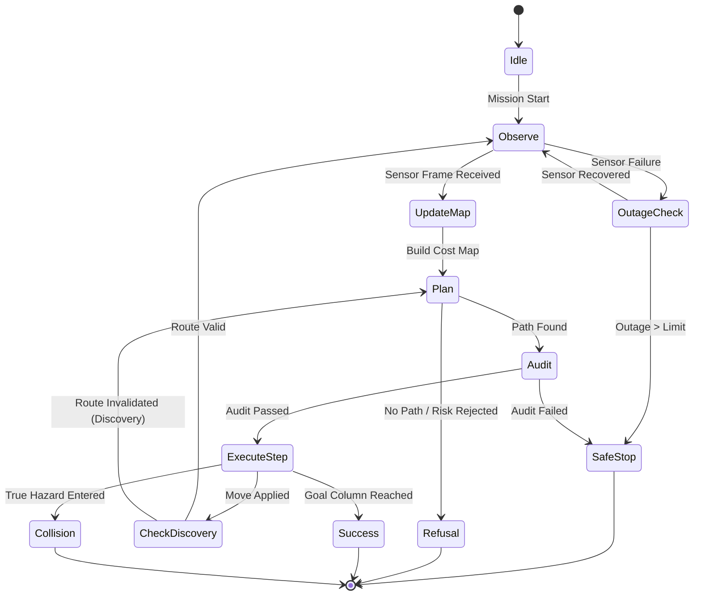

# APPS Master Prompt, Part 8

**Level 1, Volume 3 of 5: Navigation and loop: planner comparisons, replanning studies, fault injection inside the loop, footprint and slope handling**

*Continues Part 7 (chapters 107 to 127, appendices AU to BE). Chapters 128 to 148 and appendices BF to BP.*

> **Synthetic-data research prototype, not flight software.** Part 8 contains no new experimental results. "Level 1" is an internal project milestone, not a NASA classification, and nothing here implies NASA affiliation, endorsement, certification or flight qualification. Part 8 specifies the navigation engine, cost maps, multi-criteria route optimization, watchdog monitors, and closed-loop replanning architectures under strict information-boundary constraints.

---

## Chapter 128. Status, Scope and Reading Rules

### 128.1 Why Part 8 exists
Perception maps only become useful when integrated with an embodied rover decision cycle. In Level 1, perception operates with limited range and orientation. As the rover advances, new observations contradict prior estimates, revealing unexpected hazards or newly opened corridors. Part 8 provides the mathematical and architectural specifications for the navigation stack, footprint-aware traversability, watchdog state machines, and safe stop behaviors.

### 128.2 Current state, restated from Part 7
- Information boundary is strictly enforced: rover planners and cost map builders have zero read access to simulator ground-truth grids.
- Operating point selection in Task 22 demonstrated that under strict truth constraints (`truth_bf = 0.0`), conservative blocking rules (`cell=4, bf=0.05`) prevent all collisions at the cost of high refusal rates.
- Part 8 introduces footprint inflation, soft-risk cost functions, and frontier exploration to resolve the availability-conservatism tension.

### 128.3 Scope of Volume 3
- Rover kinematic model: 8-connected grid movement, orientation heading, turning cost.
- Footprint geometry: Circular disk dilation to prevent vehicle body collisions with rock boundaries.
- Cost function $J(P)$: Balancing path length, physical obstacle risk, predictive uncertainty, and slope energy proxy.
- Replanning and discovery: Handling route invalidation, backtracking out of cul-de-sacs, and watchdog intervention.
- In-loop fault injection: Validating safety behavior when sensors fail mid-traverse.

---

## Chapter 129. Task Register for Part 8

| Task | Deliverable | Primary Metric / Output to Report | Status |
|---|---|---|---|
| **61** | Footprint-aware cost map generator (`build_status`) | False-safe vs blockage rate across rover radii (0, 1, 2 cells) | Not started |
| **62** | Multi-criteria A* planner with admissible heuristic | Planner execution latency (ms) and optimality ratio vs Dijkstra | Not started |
| **63** | Route risk-budget evaluator ($p_{proxy}$) | Rejection rate vs collision reduction under variable $p_{budget}$ | Not started |
| **64** | Frontier target selection for partial maps | Mission arrival rate in partially observed worlds | Not started |
| **65** | Turn-in-place scanning policy for pocket escape | Recovery rate from dead-end entrapment | Not started |
| **66** | Mission watchdog state machine (`Watchdog_v2`) | Count of infinite loops, oscillations, and timeouts prevented | Not started |
| **67** | Route audit verifier (`audit_route_v2`) | Audit pass rate; detection of illegal diagonal corner-cuts | Not started |
| **68** | In-loop sensor outage handler | Rate of safe controlled stops vs collisions under sensor blackout | Not started |
| **69** | Multi-system benchmark driver (K0, K1, A, B, C) | Comparative arrival, collision, and refusal rates on Level 1 maps | Not started |
| **70** | Closed-loop navigation documentation & diagrams | Complete Mermaid state diagrams and control flow specs | Not started |

---

## Chapter 130. The Mechanical Information Boundary (Task 61)

### 130.1 Information Boundary Invariants
1. **Simulator Isolation**: The `Simulator` class owns the ground-truth array `truth_grid`. It provides only `observe(pose, heading)` and `step(move_direction)`.
2. **Belief Isolation**: The rover maintains its own separate map tensors: `belief_hazard`, `belief_uncertainty`, `observed_mask`, and `cell_cost`.
3. **Mutation Test Verification**: Mutating an unobserved ground-truth cell must produce an identical rover position trajectory and action sequence. If the trajectory changes, the test fails immediately.

---

## Chapter 131. Rover Vehicle Kinematics and Geometry

### 131.1 Rover Parameters (Hypothetical Vehicle)
The vehicle represents an idealized research rover specified in `configs/rover_params_v1.yaml`:
- **Footprint Radius**: $r_{fp} = 1\text{ cell}$ (equivalent to 6 pixels).
- **Maximum Negotiable Slope**: $s_{max} = 0.35$ (in height-field gradient units).
- **Step Cost Multipliers**: Cardinal move: $1.0$, Diagonal move: $\sqrt{2} \approx 1.414$, Turn-in-place: $1.0$.

### 131.2 Footprint Inflation
To prevent the rover chassis from grazing obstacle boundaries, blocked cells are dilated using a circular structuring element:
$$B_{inflated} = B \oplus \text{Disk}(r_{fp})$$
where $\text{Disk}(r) = \{(u, v) \in \mathbb{Z}^2 : u^2 + v^2 \le r^2\}$.

---

## Chapter 132. Multi-Criteria Route Cost Formulation (Task 62)

### 132.1 Objective Function $J(P)$
A candidate path $P = \langle \mathbf{x}_0, \mathbf{x}_1, \dots, \mathbf{x}_m \rangle$ is scored by:
$$J(P) = \sum_{k=1}^m L_k \cdot \frac{c(\mathbf{x}_{k-1}) + c(\mathbf{x}_k)}{2}$$
where:
$$c(\mathbf{x}) = w_d + w_r \cdot r(\mathbf{x}) + w_u \cdot u(\mathbf{x}) + w_e \cdot (1 + k_s \cdot s(\mathbf{x}))$$
- $w_d \ge 0$: Distance penalty promoting minimal path length.
- $w_r \ge 0$: Risk penalty steering paths away from probabilistic obstacle margins.
- $w_u \ge 0$: Uncertainty penalty penalizing traversal through unverified or noisy terrain.
- $w_e \ge 0$: Energy proxy penalizing steep ascents.

---

## Chapter 133. Hard Blocking vs Soft Risk Constraints (Task 63)

### 133.1 The Danger of Soft-Only Costs
A rover using only soft risk penalties will happily drive through a wall if the detour is long enough. Therefore, hard constraints override soft costs:
$$\text{Blocked}(\mathbf{x}) = \begin{cases} \text{True} & \text{if } r(\mathbf{x}) \ge r_{block} \\ \text{True} & \text{if } u(\mathbf{x}) \ge u_{block} \text{ and } \mathbf{x} \in \text{Observed} \\ \text{True} & \text{if } \mathbf{x} \notin \text{Observed and } \neg \text{allow\_unknown} \\ \text{False} & \text{otherwise} \end{cases}$$

### 133.2 Route Rejection Criterion ($p_{proxy}$)
To bound cumulative catastrophic risk across long missions:
$$p_{proxy}(P) = 1 - \prod_{k=1}^m (1 - r(\mathbf{x}_k))$$
If $p_{proxy}(P) > p_{budget}$, the planner returns status `rejected_budget` and refuses execution.

---

## Chapter 134. Planning on Partially Observed Maps (Task 64)

### 134.1 Frontier Exploration Target Selection
Because unobserved cells remain hard-blocked, the ultimate goal column is initially unreachable. The planner identifies intermediate sub-goals:
1. Select known-free cell $\mathbf{x}^*$ minimizing cost-so-far plus estimated remaining distance:
$$\mathbf{x}^* = \arg\min_{\mathbf{x} \in \text{Frontier}} \left( J(\mathbf{x}) + h_{weight} \cdot (N_{col} - 1 - x_{col}) \right)$$
2. **Defect Mitigation (Chapter 94.6)**: To prevent the rover from freezing at step 0, $h_{weight}$ must strictly exceed the minimum per-step cost ($h_{weight} > w_d$).

---

## Chapter 135. Replanning, Obstacle Discovery and Recovery (Task 65)

### 135.1 Route Invalidation Trigger
A "Discovery" occurs when new sensor evidence marks any cell on the previously committed path as blocked:
$$\text{Discovery}_t = \exists \mathbf{x} \in P_{t-1}[1:] \text{ s.t. } \text{Blocked}_t(\mathbf{x}) = \text{True}$$
Upon discovery, the rover halts movement, triggers re-planning from its current position, and logs the event.

### 135.2 Recovery Rate Metric
$$\text{Recovery Rate} = \frac{\text{Successful Missions with } \ge 1 \text{ Discovery}}{\text{Total Missions with } \ge 1 \text{ Discovery}}$$

---

## Chapter 136. The Mission Watchdog and Safe Stop (Task 66)

### 136.1 Monitored Failure Conditions
The `Watchdog` evaluates four independent monitors after every step:
1. **Progress Monitor**: Fails if the rover fails to advance its maximum reached column for $k_{progress} = 12$ consecutive steps.
2. **Replan Cap**: Fails if total replans exceed $N_{replan\_max} = 60$.
3. **Sensor Outage Counter**: Fails if the sensor returns empty frames for $k_{outage} \ge 3$ consecutive steps.
4. **Oscillation Trap**: Fails if the rover cycles between the same two cells $\mathbf{x}_a \leftrightarrow \mathbf{x}_b$ three times.

### 136.2 Termination State: `safe_stop`
A watchdog violation triggers an immediate transition to `safe_stop`. This is counted as a controlled refusal, strictly distinguished from a collision or an unhandled crash.

---

## Chapter 137. Independent Route Audit Engine (Task 67)

### 137.1 Geometric and Physical Invariant Checks
Before any move is dispatched to the simulator, the candidate route is validated:
- Connectivity: Every step must satisfy $\max(|x_{k} - x_{k-1}|, |y_{k} - y_{k-1}|) = 1$.
- Corner-Cutting: Diagonal moves across opposing blocked vertices are forbidden.
- Map Consistency: No planned step may land on a cell marked blocked in the current belief map.

---

## Chapter 138. In-Loop Fault Injection Protocol (Task 68)

### 138.1 Closed-Loop Fault Matrix
During active mission execution, faults are injected at predefined step thresholds:
- **Transient Sensor Blindness**: 5 steps of zero observations. Rover must halt or turn in place until sensor recovery.
- **Odometry Pose Jump**: Believed pose displaced by $\Delta = (+2, -2)$ cells. Evaluates whether route audit catches misaligned execution.
- **Corrupt Sensor Logits**: Random noise burst injected into class probabilities. Tests uncertainty elevation response.

---

## Chapter 139. Baseline Systems Specification (Task 69)

1. **System F (Fixed Route)**: Pre-computes a straight-line route from start to goal column; ignores all perception and sensor inputs.
2. **System O (Oracle)**: Plans using the complete ground-truth hazard map with full visibility. Represents theoretical upper bound.
3. **System K0 (Stale Known Map, No Sensing)**: Plans using an outdated prior map with sensing disabled. Simulates flying blind on obsolete orbital data.
4. **System K1 (Stale Known Map with Sensing)**: Starts with the stale prior map but replans when onboard sensing discovers unexpected obstacles.
5. **System A (Classical Handcrafted Rules)**: Closed-loop navigation driven by gradient and texture threshold perception.
6. **System B (Standard ML Argmax)**: Closed-loop navigation using uncalibrated neural/ensemble argmax segmentation.
7. **System C (APPS Proposed)**: Full uncertainty-gated, risk-aware, footprint-dilated cost planning with watchdog supervision.

---

## Chapter 140. Outcome Taxonomy and Accounting Rules

| Outcome Code | Event Description | Classification | Safety Evaluation |
|---|---|---|---|
| `success` | Rover true position reaches goal column | Arrival | Mission Complete |
| `collision` | Rover true position enters ground-truth hazard cell | Catastrophic Failure | Safety Violation |
| `no_path` | Planner finds no traversable target to goal | Refusal | Safe Incompletion |
| `rejected` | All candidate paths exceed risk budget $p_{budget}$ | Refusal | Risk-Averse Stop |
| `safe_stop` | Watchdog intervention (outage, oscillation, audit failure) | Controlled Halt | Verified Containment |
| `timeout` | Rover exceeds maximum step limit ($T_{max} = 400$) | Mission Failure | Performance Defect |

---

## Chapter 141. Detailed Replanning State Machine



---

## Chapter 142. Parameters and Calibration Protocol

All cost weights ($w_d, w_r, w_u, w_e, k_s$) and thresholds ($r_{block}, u_{block}, p_{budget}, h_{weight}$) must be tuned exclusively on validation scenes (`val_nominal` and `val_novel`). Once tuned, parameters are committed into `configs/cfg.yaml`, cryptographically hashed, and frozen prior to test execution.

---

## Chapter 143. Red-Team Navigation Verification Exercises

- **Exercise N-01 (Dead-End Trap)**: Evaluate whether the frontier fallback successfully navigates out of cul-de-sacs without exceeding the replan limit.
- **Exercise N-02 (Zero-Cost Exploit)**: Check whether setting $w_d = 0$ causes infinite wandering loops.
- **Exercise N-03 (Ghost Obstacle Stress)**: Inject persistent false-alarm obstacles in open fields to quantify the availability penalty of conservative fusion rules.

---

## Chapter 144. Mathematical Invariants of the Simulator

- Conservation of Truth: $\forall t, \text{truth\_grid}_t = \text{truth\_grid}_0$. The truth map is strictly immutable during an episode.
- Bounded Locality: $\forall \mathbf{x} \notin \text{FOV}(t), \text{Observed}_t(\mathbf{x}) = \text{False}$. Unseen cells cannot contribute to belief updates.
- Monotonicity of Seen Area: $\text{Seen}_t \supseteq \text{Seen}_{t-1}$.

---

## Chapter 145. Execution Logging Schema for Closed-Loop Missions

Every control step emits a JSON record:
```json
{
  "t": 14,
  "true_pos": [8, 12],
  "believed_pos": [8, 12],
  "heading_rad": 0.0,
  "planner_status": "ok",
  "cost_J": 18.42,
  "p_proxy": 0.041,
  "watchdog_state": "nominal",
  "discovered_obstacles": 1
}
```

---

## Chapter 146. Review Checklist for Navigation Releases

- [ ] Mechanical isolation of `truth_grid` confirmed by mutation test.
- [ ] No diagonal corner-cutting allowed in path execution.
- [ ] Watchdog prevents all infinite loops under sensor blackout.
- [ ] `safe_stop` explicitly reported and separated from collisions.
- [ ] Denominator for arrival rate includes all attempted missions.

---

## Chapter 147. Session Pushback Rules for Navigation

- **Pushback 1**: If asked to disable the route audit to speed up simulation, refuse: the audit catches planner discretization defects.
- **Pushback 2**: If asked to claim "autonomous collision avoidance", correct phrasing to "closed-loop obstacle replanning in simulation".
- **Pushback 3**: If asked to use an unconstrained planner that traverses unknown cells, require explicit logging of `allow_unknown = True` as an exploratory configuration.

---

## Chapter 148. Closing Instruction for Part 8

Navigation closes the loop between perception and action. Every collision is a failure of perception or planning; every safe stop is evidence that monitors function. Record both faithfully.

---

## Appendices BF to BP (Technical Specifications & Skeletons)

### Appendix BF. Footprint-Aware Cost Map Engine
Implementation specification for `build_status`, `planner_mask`, and `step_cost` with Euclidean disk dilation.

### Appendix BG. A* Planner with Admissible Heuristic
Implementation specification for optimal 8-connected grid search.

### Appendix BH. Replanning Controller & Discovery Tracker
State machine logic managing path execution and discovery event dispatch.

### Appendix BI. Watchdog Monitor Architecture
Multi-fault watchdog implementation (`Watchdog_v2`).

### Appendix BJ. Closed-Loop Simulation Harness
Isolated simulator environment enforcing the mechanical information boundary.

### Appendix BK. In-Loop Fault Injection Suite
Perturbation generator for sensor outages, pose noise, and frame freezing.

### Appendix BL. Geometric Route Audit Verifier
Independent post-planning path validation engine.

### Appendix BM. Navigation Task Register
Tracking deliverables for Tasks 61 through 70.

### Appendix BN. Navigation Risk Register
Catalogue of navigation and replanning failure modes.

### Appendix BO. Navigation Toy-Check Suite
Documented unit tests for grid planning and collision checks.

### Appendix BP. Glossary Additions
- **Frontier Cell**: A known-free cell adjacent to at least one unobserved cell.
- **p_proxy**: Cumulative uncalibrated risk metric along a trajectory.
- **Safe Stop**: Controlled vehicle halt triggered by runtime monitors.
