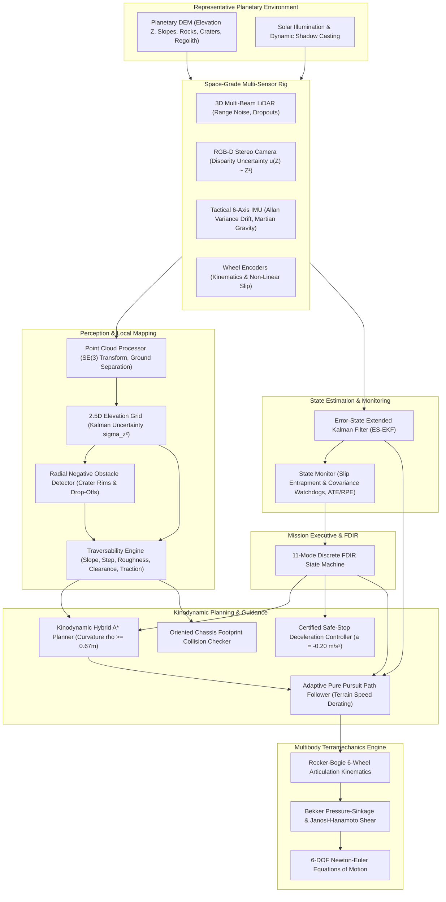

# APPS Planetary Rover Autonomous Navigation System — System Architecture

**Document ID:** APPS-ARCH-TRL5-001  
**Target Maturity:** NASA TRL 5 (Breadboard / Synthetic Laboratory Validation in Relevant Environment)  
**Safety Status:** `PROTOTYPE_LOCK = True`, `NAVIGATION_READY = False`  
**Reference Body:** Mars (Surface Gravity $g = 3.71\text{ m/s}^2$)

---

## 1. System Decomposition

The Automated Planetary Perception System (APPS) is architected as a modular, loosely-coupled robotics autonomy stack designed for autonomous navigation in unstructured extraterrestrial terrain.

---

## 2. Reference Coordinate Frames & Transformations

All spatial quantities are defined in right-handed Cartesian frames according to ISO 8855 and CCSDS standards:

| Frame Name | Symbol | Origin | Axes Definition |
| :--- | :--- | :--- | :--- |
| **World / Map Frame** | $\mathcal{W}$ | Staging landing site | $+X$: Local East, $+Y$: Local North, $+Z$: Surface Normal (Up) |
| **Base / Chassis Frame** | $\mathcal{B}$ | Rover chassis geometric center | $+X$: Forward longitudinal, $+Y$: Left lateral, $+Z$: Upward normal |
| **LiDAR Sensor Frame** | $\mathcal{L}$ | Navigation mast optical center | $+X$: Forward beam axis, $+Y$: Left, $+Z$: Upward |
| **Camera Sensor Frame** | $\mathcal{C}$ | Stereo camera left lens principal point | $+Z$: Optical depth axis, $+X$: Sensor right, $+Y$: Sensor down |
| **IMU Body Frame** | $\mathcal{I}$ | Center of tactical IMU casing | $+X$: Longitudinal accel, $+Y$: Lateral accel, $+Z$: Vertical accel |

### 2.1 Extrinsic Calibration Matrices ($SE(3)$)
Sensor poses are represented via homogeneous transformation matrices:

$$
T_{\mathcal{B}\mathcal{L}} = \begin{bmatrix} R_{\mathcal{B}\mathcal{L}} & p_{\mathcal{B}\mathcal{L}} \\ 0_{1\times 3} & 1 \end{bmatrix} \in SE(3)
$$

Nominal mounting parameters:
- **LiDAR Extrinsics**: $p_{\mathcal{B}\mathcal{L}} = [0.40, 0.0, 1.25]^T\text{ m}$, Mast pitch down: $\theta_{\text{pitch}} = -15.0^\circ$.
- **Camera Extrinsics**: $p_{\mathcal{B}\mathcal{C}} = [0.45, 0.0, 1.20]^T\text{ m}$, Mast pitch down: $\theta_{\text{pitch}} = -20.0^\circ$.
- **IMU Extrinsics**: $p_{\mathcal{B}\mathcal{I}} = [0.0, 0.0, 0.15]^T\text{ m}$, Coincident orientation: $R_{\mathcal{B}\mathcal{I}} = I_3$.

Point coordinate transformations from sensor frame $\mathcal{L}$ to world map $\mathcal{W}$:

$$
p_{\mathcal{W}} = T_{\mathcal{W}\mathcal{B}} T_{\mathcal{B}\mathcal{L}} p_{\mathcal{L}}
$$

---

## 3. Sensor Models & Noise Characteristics

### 3.1 3D Multi-Beam Navigation LiDAR
- **Configuration**: 16 virtual elevation beams spanning $\theta_{\text{el}} \in [-15^\circ, +15^\circ]$, $360^\circ$ horizontal azimuth at $2^\circ$ resolution (2,880 pulses/scan).
- **Measurement Range**: $r \in [0.30, 25.0]\text{ m}$.
- **Range Uncertainty**:
  $$\sigma_r(r) = \sigma_{0} \cdot \mu_{\text{noise}} \left(1.0 + \left(\frac{r}{r_{\text{max}}}\right)^{1.5}\right), \quad \sigma_0 = 0.02\text{ m}$$
- **Atmospheric / Dust Dropout**: Beam dropouts modeled with configurable probability $p_{\text{drop}} \in [0.0, 0.50]$.

### 3.2 Stereo RGB-D Depth Camera
- **Field of View**: $65^\circ\text{ H} \times 45^\circ\text{ V}$, resolution $32 \times 24$ depth sampling points.
- **Disparity Uncertainty**: Quadratic range error growth characteristic of optical stereopsis:
  $$\sigma_Z(Z) = \frac{Z^2}{f \cdot B} \cdot \sigma_d, \quad \sigma_Z \propto Z^2$$

### 3.3 Tactical 6-Axis Inertial Measurement Unit (IMU)
- **Accelerometers**: $3\sigma$ bias instability $0.05\text{ m/s}^2$, velocity random walk $0.015\text{ m/s}/\sqrt{\text{h}}$.
- **Gyroscopes**: $3\sigma$ bias drift $0.02^\circ/\text{s}$, angular random walk $0.005^\circ/\sqrt{\text{h}}$.
- **Martian Gravity Injection**: Under nominal level pose:
  $$a_{\text{meas}} = R_{\mathcal{W}\mathcal{B}}^T \begin{bmatrix} 0 \\ 0 \\ +g_{\text{mars}} \end{bmatrix} + a_{\text{dynamic}} + b_a + \eta_a, \quad g_{\text{mars}} = 3.71\text{ m/s}^2$$

### 3.4 Wheel Odometry & Terramechanics
- **Wheel Diameter**: $D_w = 0.50\text{ m}$ ($r_w = 0.25\text{ m}$).
- **Encoder Resolution**: 1024 pulses/revolution.
- **Longitudinal Slip**: $s = 1 - \frac{v_{\text{actual}}}{r_w \omega}$.

---

## 4. Discrete Timing, Determinism & Execution Rates

All algorithmic execution loops run at fixed, hardware-representative discrete cycle times:

| Subsystem Pipeline | Frequency | Period $\Delta t$ | Target RTOS Allocation |
| :--- | :--- | :--- | :--- |
| **Tactical IMU High-Rate Kinematics** | $100\text{ Hz}$ | $10.0\text{ ms}$ | High-priority ISR / RTEMS Core 0 |
| **Error-State EKF Prediction Step** | $100\text{ Hz}$ | $10.0\text{ ms}$ | High-priority ISR / RTEMS Core 0 |
| **Wheel Odometry EKF Measurement Update** | $10\text{ Hz}$ | $100.0\text{ ms}$ | Periodic RTOS Task (Priority 2) |
| **Path Tracking (Pure Pursuit & FDIR)** | $10\text{ Hz}$ | $100.0\text{ ms}$ | Periodic RTOS Task (Priority 2) |
| **3D LiDAR Scan Acquisition** | $2\text{ Hz}$ | $500.0\text{ ms}$ | DMA Buffer Transfer Task |
| **2.5D DEM & Traversability Evaluation** | $2\text{ Hz}$ | $500.0\text{ ms}$ | Background Processing Pipeline |
| **Kinodynamic Hybrid A* Replanning** | Event-Driven | $\le 150.0\text{ ms}$ | Asynchronous Co-Processor / DSP |

All floating-point arithmetic adheres strictly to IEEE 754 double-precision (`np.float64`) constraints. Integer index operations are bound-checked and deterministically clipped.
