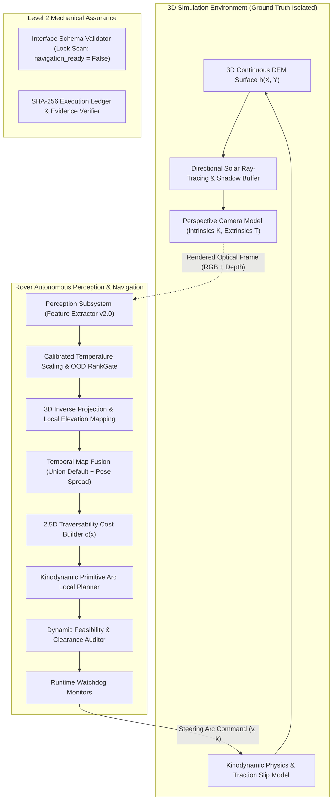

# APPS System Architecture Specification (Level 1 & Level 2)

> **Research Prototype Disclaimer**: Independent research prototype. Not flight software, not certified, not affiliated with NASA or JPL. `navigation_ready` is permanently locked to `False` under `PROTOTYPE_LOCK = True`.

---

## 1. High-Level Architecture Overview

---

## 2. Subsystem Descriptions

### 2.1 3D Continuous World Representation
- **Dense Digital Elevation Model (DEM)**: Continuous surface $Z = h(X, Y)$ interpolated bilinearly across arbitrary metric coordinates.
- **Surface Geometry**: Continuous analytic normal vectors $\mathbf{n}(x, y)$, slope gradient $\nabla h$, and multi-scale roughness $g(x, y)$.
- **Directional Solar Ray-Tracing**: Simulates solar illumination based on azimuth $\alpha$ and elevation $\theta$ with ray-marching shadow buffer occlusions.

### 2.2 Vehicle Kinematics & Stability Model
- **Planar Curvature Kinematics**: Unicycle-style drive model parameterized by forward speed $v$ and path curvature $k = 1/R$.
- **Command Envelope & Clipping**: Hard limits $v_{max} = 0.50\text{ m/s}$ and $k_{max} = 1.50\text{ m}^{-1}$ with runtime clip counters.
- **Vehicle Attitude**: Pitch $\theta$ and roll $\phi$ computed continuously from DEM contact normals.
- **Slope Slip Physics**: Dynamic traction loss scaling with slope excess $s - s_{safe}$ to model realistic wheel slip and tip-over hazards.

### 2.3 Perspective Sensing & Reprojection
- **Pinhole Camera Model**: Forward-facing stereo/monocular camera with focal length $f_x, f_y$, principal point $(c_x, c_y)$, and mounting tilt.
- **Range-Squared Depth Uncertainty**: Measurement error grows with the square of range: $\Delta Z \propto Z^2 \Delta d / (f B)$.
- **Visible Sector Mapping**: Only ground cells within the line-of-sight frustum are updated; unobserved ground is flagged as Unknown ($u(x) = 1.0$) and hard-blocked by default.

### 2.4 Kinodynamic Primitive Local Planner
- **Arc Motion Primitives**: Evaluates discrete set of precomputed constant-curvature arcs obeying vehicle turning limits.
- **Swept Footprint Collision Check**: Rasterizes full rectangular vehicle body $(1.20\text{ m} \times 0.90\text{ m})$ along each candidate arc.
- **Multi-Criteria Optimization**: Minimizes traversal cost $J$, maximizes goal progress, and enforces route risk budgeting $p_{proxy} \le p_{budget}$.

### 2.5 Interface Schema & Security Boundary
- **JSON Schema v2.0**: Standardized interchange format across perception, mapper, and planner.
- **Prototype Guard Invariant**: All messages assert `navigation_ready = False`. Any message attempting to set `True` is rejected with `lock_violation`.
- **Truth Protection**: Any message body containing truth-named keys (`truth_grid`, `_truth`) is rejected with `forbidden_key`.
