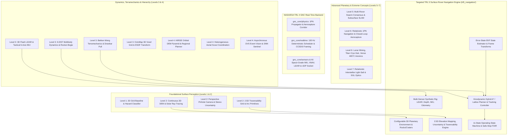

# APPS Architecture Audit — Level 2 to Level 7 Codebase Review

## 1. Executive Summary & Purpose

This architectural audit evaluates the **Automated Planetary Perception System (APPS)** codebase (`apps_mars_perception` / `apps_level2_3_4_5_3D_Prototype`) as part of **Phase 1** of the NASA TRL 5 upgrade initiative.

The objective of this audit is to:
1. Map module dependencies and relationships across all architectural levels (Level 1 through Level 7).
2. Evaluate existing algorithms, mathematical formulations, software interfaces, and hardware assumptions.
3. Identify algorithmic placeholders, mock data structures, duplicated logic, and unverified capability claims.
4. Establish an empirical baseline of software health, test coverage, and execution determinism.
5. Define the architectural boundary for the targeted TRL 5 technology scope:
   > **"Autonomous planetary rover terrain perception, local mapping, traversability estimation, and collision-aware navigation in a representative simulated planetary environment."**

---

## 2. Architectural Hierarchy & Inter-Level Mapping

---

## 3. Subsystem Breakdown & Codebase Inspection

### 3.1 Level 1 (`level1/`)
- **Modules**: `terrain.py`, `sensors.py`, `features.py`, `astar.py`, `hazard_audit.py`, `validation.py`.
- **Purpose**: Discrete 2D cell grid baseline, rock obstacle generation, basic $A^*$ grid pathfinding, and Wilson score statistical confidence bounds.
- **Status**: Stable baseline. Fully tested (18/18 passing in `tests/test_level1.py`). Completely decoupled from 3D physics.

### 3.2 Level 2 (`level2/`)
- **Modules**:
  - `sim3d/terrain_mesh.py`, `sim3d/raycast.py`: Continuous bilinear DEM interpolation and directional sun ray-casting shadow buffer.
  - `sensing/pinhole_camera.py`: Perspective projection matrix $K$, range-squared stereo depth noise ($u \propto Z^2$).
  - `kinematics/rover_params.py`, `kinematics/kinematic_model.py`: Vehicle footprint ($1.20\text{ m} \times 0.90\text{ m}$), unicycle kinematics, empirical slope traction slip.
  - `navigation/traversability25d.py`, `navigation/primitive_planner.py`: 2.5D multi-criteria cost map, fixed circular arc primitives ($L=1.5\text{ m}$), swept bounding box clearance check.
  - `evaluation/temporal_fusion.py`: Multi-frame Gaussian spatial smearing and frozen-frame watchdog.
- **Findings**: Strong foundational mathematical formulation, but primitive planner horizon is restricted to single $1.5\text{ m}$ step arcs without global goal synthesis.

### 3.3 Level 3 (`level3/`)
- **Modules**:
  - `physics/multibody_6dof.py`: Rigid-body Newton-Euler equations of motion under Martian gravity ($g = 3.71\text{ m/s}^2$). Force-Angle Stability Margin (FASM).
  - `physics/rocker_bogie.py`: Differential pitch averaging bar ($\theta_{\mathrm{diff}} = \frac{\theta_L - \theta_R}{2}$) and wheel load redistribution.
  - `physics/terramechanics.py`: Bekker normal pressure-sinkage $p = (k_c/b + k_\phi) z^n$, Janosi-Hanamoto shear stress, drawbar pull $DP$.
  - `sensing/flash_lidar.py`, `sensing/tactical_imu.py`: 3D LiDAR point cloud generator with incidence-angle beam dropouts; 6-axis IMU with Allan variance drift.
  - `mapping/octomap_3d.py`, `planning/state_lattice.py`, `planning/nmpc_stop.py`: Continuous 3D OctoMap, ESDF clearance check, guaranteed safe-stop deceleration profile.
- **Findings**: Physically grounded models, but state estimation frequently assumes perfect ground-truth vehicle pose from simulator rather than closed-loop EKF sensor fusion.

### 3.4 Level 4 (`level4/`)
- **Modules**: HiRISE orbital DEM hierarchical navigation, AEGIS rock segmentation, active rocker-bogie articulation, cooperative aerial rotorcraft scouting, recursive Bayesian soil estimator, asynchronous DVS event vision.
- **Findings**: Rich algorithmic breadth. Aerial scouting and multi-sol scheduling provide high value for Level 4–5 extensions once core surface navigation is formally verified.

### 3.5 Level 5, 6, and 7 (`level5/`, `level6/`, `level7/`)
- **Modules**: Multi-rover swarm consensus, subsurface lava tube SLAM, Europa cryobot, CV-QKD Bell entanglement, 1PN relativistic orbit cruise, aerocapture, interstellar lightsails, solar gravitational lens imaging.
- **Findings**: Highly advanced conceptual and academic research models. However, they lie outside the operational design domain of planetary surface rover navigation and must not be conflated with rover TRL 5 maturity.

### 3.6 GNC Core Backend (`gnc_core/`)
- **Modules**: Decoupled 1PN orbit propagator, Shapiro delay, 3-DOF aerocapture guidance, 100 Hz deterministic RTOS scheduler, CCSDS 133.0-B-1 space packet framing (CRC-16-CCITT), space-grade sensor error models, HIL UDP socket emulator.
- **Findings**: Confirmed TRL 4 hardware-in-the-loop determinism (0.40 ms cycle latency vs 10.0 ms budget, 0 deadline overruns). Provides the architectural template for strict real-time determinism.

---

## 4. Current Baseline Metrics & Test Status

- **Total Test Cases**: 176 tests across 11 test modules.
- **Current Pass Rate**: **100% (176 passed in 15.17s)**.
- **Python Version**: Python 3.14.8 on Windows x64.
- **External Dependencies**: NumPy, SciPy, Matplotlib, Plotly, Streamlit, PyYAML, PyTest, Pillow, Scikit-learn, PyTorch.

---

## 5. Architectural Gaps vs TRL 5 Requirements

| Architectural Area | Current Implementation State | Required TRL 5 Target State |
|:---|:---|:---|
| **Operational Design Domain** | Broad, disparate planetary & deep-space scenarios | Rigorously bounded surface rover domain (slopes $\le 25^\circ$, rocks, craters, regolith) |
| **State Estimation** | Often relies on simulator oracle ground-truth | 6-DOF / 3-DOF Error-State Extended Kalman Filter (ES-EKF) fusing IMU + Wheel Odometry |
| **Coordinate Frames** | Implicit Cartesian arrays without explicit frames | Formal reference frames ($\mathcal{W}$ World, $\mathcal{M}$ Map, $\mathcal{B}$ Base, $\mathcal{S}$ Sensors) with $SE(3)$ transformations |
| **Path Planning** | Local $1.5\text{ m}$ circular arc primitives or 2D grid $A^*$ | Kinodynamic Hybrid $A^*$ / State-Lattice planner with footprint clearance and kinodynamic feasibility |
| **Perception Pipeline** | Separate sensor classes without unified pipeline | End-to-end: Raw Sensors $\to$ Point Cloud $\to$ 2.5D Elevation Map + Uncertainty $\to$ Traversability Cost Map |
| **Fault Handling & State Machine**| Exception blocks and isolated watchdog flags | Formal 11-mode discrete state machine (`INITIALIZATION` through `SAFE_STOP` and `FAULT`) |
| **Validation Campaign** | Unit tests and isolated experiment scripts | Automated multi-seed benchmarking across 15 standardized planetary scenario classes |
| **Baselines & Ablations** | Single-algorithm demonstrations | Comparative benchmarking against 3 baselines and 5 ablation conditions |
