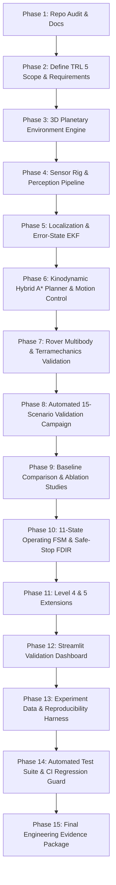

# APPS NASA TRL 5 Implementation Roadmap & Phased Execution Plan

## 1. Engineering Strategy

To transform the **Automated Planetary Perception System (APPS)** into a technically rigorous, experimentally validated planetary rover perception and autonomous navigation research system demonstrating characteristics consistent with **Technology Readiness Level 5 (TRL 5)**, work is organized into an incremental, traceable 15-phase execution plan.

---

## 2. Phased Execution Roadmap

### Phase Schedule & Implementation Breakdown

| Phase | Title | Core Deliverables & Technical Scope |
|:---|:---|:---|
| **Phase 1** | Repository Audit & Preservation | Baseline test run (176/176 pass), architecture audit, capability matrix, technical debt ledger, roadmap. |
| **Phase 2** | Define TRL 5 Target Scope | System requirements, operational design domain (ODD), acceptance criteria, and traceability matrix in `docs/`. |
| **Phase 3** | Planetary Environment Simulation | Configurable 3D DEM, slope gradients ($\le 25^\circ$), crater generator, rock/boulder fields, loose regolith patches, narrow passages in `trl5_navigation/environment/`. |
| **Phase 4** | Real Multi-Sensor Perception Pipeline | Synthetic sensor rig (RGB-D, 3D LiDAR, 6-axis IMU, wheel odometry), point cloud coordinate transforms, 2.5D elevation grid with uncertainty, multi-criteria traversability cost map in `trl5_navigation/perception/`. |
| **Phase 5** | Localization & State Estimation | Explicit reference frames ($\mathcal{W}, \mathcal{M}, \mathcal{B}, \mathcal{S}$), Error-State Extended Kalman Filter (ES-EKF) fusing odometry and IMU, trajectory error metrics (ATE / RPE) in `trl5_navigation/localization/`. |
| **Phase 6** | Kinodynamic Path Planning & Control | Kinodynamic Hybrid $A^*$ / State-Lattice planner with minimum turning radius ($\kappa_{\max} = 1.5\text{ m}^{-1}$), swept chassis footprint collision checking, closed-loop path follower, and dynamic replanning in `trl5_navigation/planning/`. |
| **Phase 7** | Physics & Terramechanics Validation | 6-DOF rigid-body Newton-Euler equations under Martian gravity ($g = 3.71\text{ m/s}^2$), rocker-bogie kinematics, Bekker-Wong pressure-sinkage and drawbar pull validation in `trl5_navigation/dynamics/`. |
| **Phase 8** | 15-Scenario Validation Campaign | Automated multi-seed test campaign across 15 planetary scenario classes, logging JSON records of all primary metrics in `experiments/run_trl5_campaign.py`. |
| **Phase 9** | Baselines & Ablation Studies | Quantitative comparative benchmarking against 3 baselines (Straight-line, 2D Grid $A^*$, Terrain $A^*$) and 5 ablation conditions in `trl5_navigation/experiments/`. |
| **Phase 10** | Operating FSM & Safe-Stop FDIR | Formal 11-mode discrete state machine (`INITIALIZATION` to `FAULT`) with fail-safe safe-stop deceleration in `trl5_navigation/executive/`. |
| **Phase 11** | Level 4 & 5 Extensions | Cooperative aerial scout elevation relay and multi-rover decentralized map sharing in `trl5_navigation/extensions/`. |
| **Phase 12** | Professional Validation Dashboard | Interactive Streamlit dashboard (`apps_trl5_dashboard.py`) with 3D terrain, trajectory plots, real-time sensor views, traversability maps, and campaign analytics. |
| **Phase 13** | Experiment Management & CLI | Structured directories (`configs/`, `scenarios/`, `results/trl5/`, `reports/`), machine-readable JSON/CSV logs, and CLI reproduction harness. |
| **Phase 14** | Software Engineering & Testing | Comprehensive unit and integration test suite (`tests/test_trl5_*.py`), type hints, docstrings, and zero regressions across all 176 existing tests. |
| **Phase 15** | Final Engineering Evidence Package | Complete suite of 9 formal verification documents in `docs/` summarizing requirements, architecture, algorithms, and honest TRL 5 assessment. |
