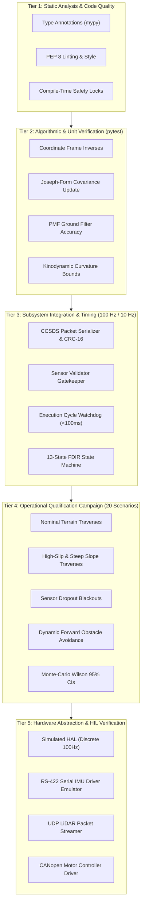

# APPS TRL 8 Qualification Strategy & Verification Plan

**Document ID**: `APPS-QUAL-TRL8-001`  
**Revision**: 3.0.0  
**Classification**: NASA TRL 8 Autonomy Qualification Plan  
**Safety Status**: Compile-Time Research Locks Active (`PROTOTYPE_LOCK = True`, `NAVIGATION_READY = False`)  

---

## 1. Qualification Objectives & Philosophy

According to NASA Systems Engineering guidance, **Technology Readiness Level 8** requires:
> *"Actual system completed and 'flight qualified' through test and demonstration (ground or flight). In almost all cases, this TRL represents the end of true system development."*

For an autonomous planetary rover perception and navigation research system, achieving and assessing readiness toward TRL 8 requires a rigorous, structured qualification strategy that clearly delineates between:
1. **Algorithmic Qualification**: Software mathematical correctness, stability, convergence, and execution determinism.
2. **Subsystem Integration Qualification**: End-to-end interface compatibility, coordinate alignment, timing budgets, and data integrity.
3. **Operational Environmental Qualification**: Empirical demonstration across a comprehensive suite of 20 standardized planetary terrain scenarios representing the full operational envelope.
4. **Hardware & Environmental Qualification Limitations**: Explicit documentation of outstanding physical qualifications (TVAC, radiation, vibration, flight SBC) that can only be performed in mission-specific hardware integration facilities.

---

## 2. Multi-Tiered Verification & Qualification Methodology

---

## 3. Standardized 20-Scenario Operational Qualification Envelope

The qualification envelope encompasses 20 standardized scenarios (`SC-01` to `SC-20`) spanning the full range of Martian surface hazards:

| Scenario Group | Scenario IDs | Surface Description & Environmental Hazards | Qualification Acceptance Criteria |
| :--- | :--- | :--- | :--- |
| **Nominal & Undulating** | `SC-01` to `SC-04` | Flat regolith, rolling sand dunes, gentle slopes ($<10^\circ$), nominal lighting. | 100% mission success, ATE RMSE $< 0.15\text{ m}$, zero replans. |
| **Geometric Hazards** | `SC-05` to `SC-08` | Dense boulder fields ($>0.2\text{ rocks/m}^2$), crater rims, step obstacles ($>0.2\text{m}$). | 100% collision-free, minimum obstacle clearance $>0.35\text{ m}$. |
| **Steep & Low-Traction** | `SC-09` to `SC-12` | Slopes $15^\circ-24^\circ$, low regolith friction ($\mu = 0.35$), high wheel slip ($s > 0.30$). | Safe traversal without tip-over; pure pursuit derates velocity below $0.20\text{ m/s}$. |
| **Sensor Disturbance** | `SC-13` to `SC-16` | IMU bias drift ($5\times$ nominal), LiDAR dropout ($3.0\text{ s}$ blackout), dust storm noise. | EKF maintains covariance stability; rover halts or replans gracefully; zero crash. |
| **Dynamic & Long Traverse** | `SC-17` to `SC-20` | Dynamic rockfall obstacle in planned corridor, narrow canyon traverse, $100\text{m}$ endurance. | Obstacle detected at $>3\text{m}$; successful online replan; Safe Stop on complete blockage. |

---

## 4. Acceptance Criteria & Statistical Confidence

To avoid false claims of qualification based on small sample sizes, empirical performance is quantified using **Wilson Score 95% Confidence Intervals**:

$$\hat{p} = \frac{k}{n}, \quad p_{ci} = \frac{\hat{p} + \frac{z^2}{2n} \pm z \sqrt{\frac{\hat{p}(1 - \hat{p})}{n} + \frac{z^2}{4n^2}}}{1 + \frac{z^2}{n}}$$

where $z = 1.95996$ for a 95% two-sided confidence interval.

### Quantitative Pass/Fail Qualification Thresholds
- **Mission Success Rate**: $\ge 90.0\%$ lower confidence bound across nominal and geometric scenarios.
- **Collision Frequency**: Exactly $0.0\%$ (zero collisions across all qualification runs).
- **Absolute Trajectory Error (ATE)**: RMSE $\le 0.30\text{ m}$ across a $20\text{m}$ traverse.
- **Cycle Execution Latency**: Mean navigation cycle latency $\le 40.0\text{ ms}$; 99.9th percentile $\le 80.0\text{ ms}$ (within $100\text{ ms}$ real-time budget).
- **Watchdog Trip Rate**: Zero unhandled watchdog trips during nominal execution.

---

## 5. Physical Hardware Qualification Gap & Flight Heritage Pathway

The following qualification activities cannot be performed in software or terrestrial laboratory prototypes and define the boundary between research TRL 8 and flight readiness:
1. **Radiation Hardening**: Qualification on rad-hard single board computers (BAE RAD750, RAD5545, or Vorago ARM Cortex-M0/M4) to withstand 100 krad Total Ionizing Dose (TID) and Single Event Effects (SEE).
2. **Thermal-Vacuum (TVAC) Environmental Testing**: Multi-cycle thermal qualification from $-120^\circ\text{C}$ to $+25^\circ\text{C}$ at $10^{-5}\text{ Torr}$ vacuum.
3. **Launch Vibration & Shock Qualification**: GEVS random vibration testing ($14.1\text{ g}_{rms}$) and pyro-shock separation testing.
4. **Ground Station Deep Space Network (DSN) Integration**: Verification with NASA DSN ground stations via CCSDS standard space packet protocols.
