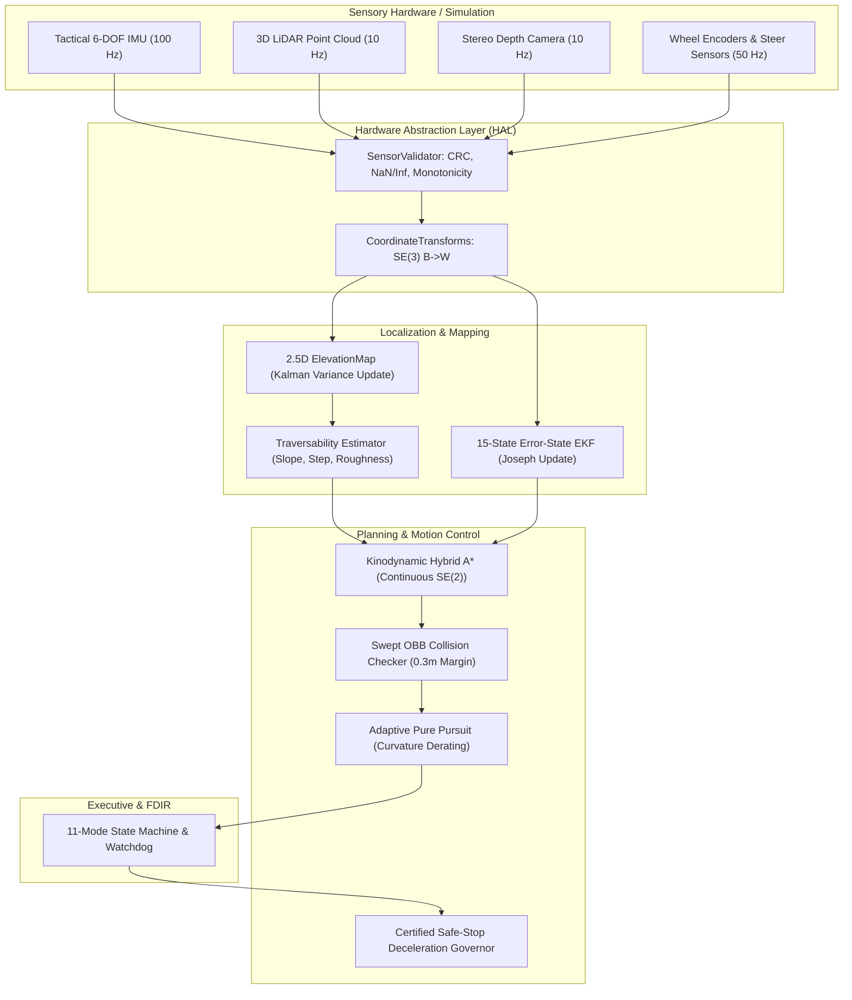

# System Integration and Interface Control Document (ICD)
**Project Name**: APPS — Automated Planetary Perception System (TRL 7)  
**Document Identifier**: APPS-TRL7-ICD-002  
**Software Baseline**: `v2.7.0-trl7`  

---

## 1. Subsystem Architecture Overview

The APPS TRL 7 system architecture decouples physical or simulated hardware interfaces from autonomous decision-making through discrete abstraction layers:



---

## 2. Telemetry Packet Structures & CCSDS Space Framing

All inter-subsystem data streams are serialized in standard binary formats with 16-byte CCSDS-compatible headers:

### 2.1 Packet Header Format (16 Bytes)
```
 0                   1                   2                   3
 0 1 2 3 4 5 6 7 8 9 0 1 2 3 4 5 6 7 8 9 0 1 2 3 4 5 6 7 8 9 0 1
+-+-+-+-+-+-+-+-+-+-+-+-+-+-+-+-+-+-+-+-+-+-+-+-+-+-+-+-+-+-+-+-+
| Ver (3) | Type |  APID (11)   | Seq Flag (2) | Seq Count (14) |
+-+-+-+-+-+-+-+-+-+-+-+-+-+-+-+-+-+-+-+-+-+-+-+-+-+-+-+-+-+-+-+-+
|                         Packet Length                         |
+-+-+-+-+-+-+-+-+-+-+-+-+-+-+-+-+-+-+-+-+-+-+-+-+-+-+-+-+-+-+-+-+
|                    Timestamp Seconds (Float64)                |
+-+-+-+-+-+-+-+-+-+-+-+-+-+-+-+-+-+-+-+-+-+-+-+-+-+-+-+-+-+-+-+-+
```

### 2.2 APID Assignments
- `0x101`: IMU Measurement Telemetry (Gyro, Accel, Temperature, CRC-16)
- `0x102`: 3D LiDAR Return Scan (Point array, intensities, return count)
- `0x103`: Stereo Depth Camera Grid Frame
- `0x104`: 6-Wheel Drive & 4-Corner Steering Odometry
- `0x105`: Locomotion Actuator Command Packet (Speed, Steer, E-Stop)
- `0x106`: FDIR State Machine Telemetry & Fault Annunciation

---

## 3. Spatial Reference Frame Hierarchy

All coordinate transformations satisfy rigid-body $SE(3)$ composition:
$$T_{\mathcal{W}}^{\mathcal{L}} = T_{\mathcal{W}}^{\mathcal{B}} \cdot T_{\mathcal{B}}^{\mathcal{L}}$$

1. **World Frame ($\mathcal{W}$)**: Local Tangent Plane (LTP) East-North-Up. Origin fixed at initial rover boot position.
2. **Body Frame ($\mathcal{B}$)**: Vehicle structural center of mass. $+X$ forward, $+Y$ port (left), $+Z$ zenith (up).
3. **LiDAR Frame ($\mathcal{L}$)**: Rigidly mounted on front mast:
   $$\vec{t}_{\mathcal{B}}^{\mathcal{L}} = [+1.0\text{ m}, 0.0\text{ m}, +1.8\text{ m}]^T, \quad R_{\mathcal{B}}^{\mathcal{L}} = I_{3\times 3}$$
4. **Stereo Camera Frame ($\mathcal{C}$)**: Optical convention: $+Z_{\mathcal{C}}$ optical axis forward, $+X_{\mathcal{C}}$ right, $+Y_{\mathcal{C}}$ down.
5. **IMU Frame ($\mathcal{I}$)**: Co-located near navigation center:
   $$\vec{t}_{\mathcal{B}}^{\mathcal{I}} = [+0.2\text{ m}, 0.0\text{ m}, +0.4\text{ m}]^T$$

---

## 4. Hardware Abstraction Layer & Driver Emulators

- **`SerialIMUDriver`**: Emulates high-grade tactical IMU serial communication over RS-422 / UART at 115200 baud with binary sync words (`0x75 0x65`), 64-bit IEEE 754 floating point decoding, and CCITT-16 CRC verification.
- **`EthernetLiDARDriver`**: Listens for UDP broadcast packets on port 2368, converting spherical laser firing returns into Cartesian points in sensor frame.
- **`MotorControllerCAN`**: Encodes continuous speed and steering commands into standard CAN 2.0B / CANopen frames with a 250 ms heartbeat watchdog.
- **`EStopMonitor`**: Monitors physical emergency stop circuit and deadman switch line. If heartbeats lapse beyond 500 ms, the system commands an unrecoverable hardware halt.
