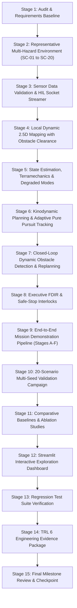

# APPS Planetary Rover Autonomous Navigation System — TRL 6 Implementation Plan

**Document ID:** APPS-PLAN-TRL6-004  
**Target Maturity:** NASA TRL 6 (System/Subsystem Model or Prototype Demonstration in a Relevant Environment)  
**Safety Invariants:** `PROTOTYPE_LOCK = True`, `NAVIGATION_READY = False`  
**Standard References:** NASA SP-2016-6105 Rev 2, NASA-STD-7009A, NASA-STD-8739.8

---

## 1. Implementation Roadmap & Phase Sequencing

The TRL 6 upgrade follows a 15-stage engineering sequence designed to integrate all perception, estimation, planning, and control subsystems into a unified prototype:

---

## 2. Work Breakdown Structure (WBS)

### Work Package 1: Environment & Scenarios (`trl6_navigation/environment/`)
- Upgrade `planetary_terrain.py` with multi-scale procedural perlin-like undulations, configurable boulder size-frequency distributions, impact craters, and Bekker-Wong regolith properties.
- Implement `scenario_generator.py` defining 20 standardized scenario classes (SC-01 to SC-20) with deterministic PRNG seed control.

### Work Package 2: Sensors & Hardware-in-the-Loop (`trl6_navigation/sensors/` & `trl6_navigation/hil/`)
- Create `sensor_validator.py` performing runtime telemetry validation (stale packet detection, timestamp monotonicity checks, measurement sanity clipping, checksum validation).
- Create `hil_packet_streamer.py` framing sensor data into standard CCSDS telemetry packets and streaming over local UDP sockets to emulate breadboard flight computer telemetry.

### Work Package 3: Perception & Dynamic Mapping (`trl6_navigation/perception/`)
- Enhance `elevation_mapping.py` with temporal obstacle decay and sensor ray-clearing to remove transient obstacles.
- Integrate distance-normalized radial negative obstacle detection to reliably catch crater bowls without false triggers on slopes.
- Calculate quantitative perception metrics (IoU, precision, recall, elevation RMSE) against ground truth.

### Work Package 4: Localization & Dynamics (`trl6_navigation/localization/` & `trl6_navigation/dynamics/`)
- Refine 15-state Error-State EKF with Joseph-form covariance updates and tactical IMU bias propagation.
- Implement covariance divergence watchdog and slip entrapment watchdog in `state_monitor.py`.
- Formulate Rocker-Bogie passive suspension kinematics and Bekker-Wong soil mechanics in `rocker_bogie.py` and `terramechanics.py`.

### Work Package 5: Kinodynamic Planning & Control (`trl6_navigation/planning/`)
- Harden Kinodynamic Hybrid A* with terminal Reeds-Shepp analytic expansion, Voronoi heuristic, and swept OBB collision checking.
- Connect Adaptive Pure Pursuit tracker with terrain-cost speed derating and certified constant-jerk safe-stop deceleration controller ($a = -0.20\text{ m/s}^2$).

### Work Package 6: Mission Demonstration & Campaign (`trl6_navigation/mission/` & `trl6_navigation/experiments/`)
- Implement `mission_executor.py` executing Stages A through F with dynamic obstacle injection at $t = 5\text{ s}$.
- Implement `campaign_runner.py` executing the 20 standardized scenarios with Wilson score 95% confidence intervals.
- Implement `baselines.py` (Straight-Line, 2D Grid A*, Terrain A*, Kinodynamic Hybrid A*) and `ablations.py`.

### Work Package 7: Interactive Dashboard & Documentation
- Build `apps_trl6_dashboard.py` featuring 3D Plotly DEM rendering, dynamic obstacle placement, real-time path replanning, multi-sensor telemetry, Wilson CI charts, and FDIR monitors.
- Complete the 11 required TRL 6 documentation packages in `docs/`.
- Verify 100% test pass rate across new and legacy tests.
