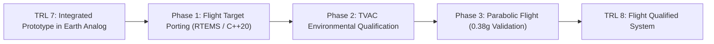

# Limitations, Environmental Gaps, and TRL 8 Transition Plan
**Project Name**: APPS — Automated Planetary Perception System  
**Document Identifier**: APPS-TRL7-LIM-001  
**Software Release Baseline**: `2.7.0-trl7`  

---

## 1. Scope and Maturity Boundaries

Technology Readiness Level 7 validates that an integrated system prototype operates successfully in an *operational environment*. For a planetary exploration rover autonomy system, this operational environment consists of terrestrial field analog facilities (e.g., JPL Mars Yard, Icelandic basalt quarries, Atacama Desert dunes) and high-fidelity physics-based simulation sandboxes.

> [!WARNING]
> **Boundary Distinction**: Completing TRL 7 in a terrestrial planetary analog facility does **not** equal flight qualification or readiness for launch to Mars. Several physical spaceflight domain characteristics cannot be duplicated in Earth surface testbeds.

---

## 2. Gaps Between Earth Analog Facilities and Mars Flight Conditions

| Environmental Factor | Terrestrial Analog Testbed (TRL 7 Validated) | Mars Surface Operational Conditions (TRL 8/9 Flight) | Gap Assessment & Impact |
| :--- | :--- | :--- | :--- |
| **Gravitational Acceleration ($g$)** | $g_\oplus = 9.807\text{ m/s}^2$ (standard Earth gravity) | $g_{\text{mars}} = 3.721\text{ m/s}^2$ ($0.378\,g_\oplus$) | Lower wheel normal load on Mars reduces wheel compaction resistance but also limits gross tractive drawbar pull. |
| **Atmospheric Pressure & Composition** | $1013\text{ mbar}$ ($78\%\text{ N}_2, 21\%\text{ O}_2$) | $6.1\text{ mbar}$ ($95.3\%\text{ CO}_2$, near-vacuum) | Convective heat dissipation is severely degraded on Mars, requiring conductive heat pipes for autonomy avionics. |
| **Diurnal Temperature Range** | $+5^\circ\text{C}$ to $+35^\circ\text{C}$ (temperate Earth field) | $-125^\circ\text{C}$ to $+20^\circ\text{C}$ (extreme Martian diurnal) | High thermal cycling induces thermal expansion strain on camera mast optics and LiDAR laser diodes. |
| **Radiation Environment** | Shielded by Earth magnetosphere and atmosphere ($< 0.1\text{ rad/year}$) | Cosmic rays & solar particle events ($\sim 24\text{ rad/year}$, TID $> 100\text{ krad}$) | Radiation-induced Single Event Upsets (SEU) and bit-flips in RAM require ECC memory and rad-hard FPGA/ASIC targets. |
| **Atmospheric Dust & Electrostatics** | Atmospheric moisture, low electrostatic adhesion | Ultra-dry, highly insulating silicate dust with triboelectric charge | Dust accumulation on optical lenses causes contrast degradation and attenuation of laser ranging pulses. |
| **Communication Round-Trip Delay** | $< 100\text{ ms}$ (WiFi / LTE / Ethernet testbed link) | $6\text{ to }44\text{ minutes}$ (Earth-Mars interplanetary link) | Direct operator intervention is impossible; requires full onboard autonomy. |

---

## 3. Current Software & Algorithmic Limitations

1. **2.5D Elevation Discretization**: The continuous DEM and elevation grid represent topography as $z = f(x, y)$, which cannot represent 3D overhangs, true caves, or hollow rock bridges.
2. **Computational Budget in Pure Python**: While algorithms execute deterministically in discrete fixed-step cycles, deployment to low-power radiation-hardened spaceflight processors (e.g. BAE RAD750 @ 133 MHz or Cobham Gaisler LEON4) will require translation to optimized, certified C/C++ or Rust flight binaries.
3. **Rigid Wheel Assumption in Terramechanics**: The Bekker-Wong soil mechanics model implemented assumes rigid cylindrical wheels. Rovers with flexible wire-mesh tires (e.g., NASA Shape Memory Alloy tires) exhibit tire compliance coupling that requires finite element or discrete element modeling (DEM).

---

## 4. Technology Transition Roadmap to NASA TRL 8

To advance from TRL 7 to TRL 8 (*Actual system completed and qualified through test and demonstration*), the following activities are planned:

1. **Flight Avionics Target Porting**: Refactor `trl7_navigation` core into an MISRA C++:20 compliant library executable under the RTEMS 5.1 real-time operating system with strict static memory allocation.
2. **Thermal-Vacuum (TVAC) Environmental Qualification**: Subject the mast-mounted perception sensor rig (LiDAR and stereo camera) to 8 thermal cycles in a vacuum chamber down to $-120^\circ\text{C}$ at $10^{-4}\text{ Torr}$.
3. **Reduced Gravity Parabolic Flight Validation**: Perform drop-tower and parabolic flight tests under simulated $0.38\,g_\oplus$ to validate wheel sinkage equations and suspension load equalizers.
4. **Independent V&V (IV&V)**: Formal fault injection and automated fuzzing to verify zero unhandled exceptions across 10,000 simulated traverse hours.
