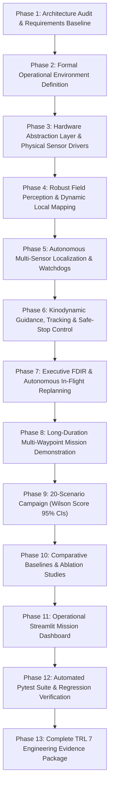

# APPS Planetary Rover Autonomous Navigation System — TRL 7 Implementation Roadmap

**Document ID:** APPS-ROADM-TRL7-003  
**Target Maturity:** NASA TRL 7 (Operational Environment Demonstration)  
**Safety Invariants:** `PROTOTYPE_LOCK = True`, `NAVIGATION_READY = False`  
**Reference Environment:** Planetary Analog Field Testbed (Earth Basalt / Sand Analog vs Mars Surface)

---

## 1. Phase Breakdown Structure

---

## 2. Work Packages & Subsystem Allocations

- **WP-01: Operational Environment & 20 Scenarios (`trl7_navigation/environment/`)**:
  - `planetary_terrain.py`: 3D continuous DEM with slope, rocks, craters, regolith friction, and solar ray-tracing.
  - `scenario_generator.py`: 20 standardized scenarios (SC-01 to SC-20) with deterministic PRNG seed control.
- **WP-02: Hardware Abstraction Layer & Telemetry Validation (`trl7_navigation/hardware/` & `sensors/`)**:
  - `hardware_interface.py`: Abstract sensor and actuator base classes.
  - `simulated_hal.py`: Bridges simulated environment to the HAL.
  - `physical_sensor_driver.py`: Representative physical sensor driver interfaces with hardware E-Stop heartbeats.
  - `sensor_validator.py`: Space-grade telemetry data validator checking timestamp monotonicity, NaN/Inf rejection, and CRC checksums.
  - `coordinate_transforms.py`: Rigid-body $SE(3)$ homogeneous transformations between World $\mathcal{W}$, Base $\mathcal{B}$, LiDAR $\mathcal{L}$, Camera $\mathcal{C}$, and IMU $\mathcal{I}$.
- **WP-03: Perception & 2.5D Mapping (`trl7_navigation/perception/`)**:
  - `point_cloud_processor.py`: Voxel downsampling, normal plane estimation, and invariant bin-lift relative ground elevation subtraction.
  - `elevation_mapping.py`: 2.5D Elevation Grid with Kalman height variance pooling, distance-normalized radial negative obstacle detection, and temporal obstacle decay/ray-clearing.
  - `traversability.py`: Multi-criteria traversability cost map (slope, step, roughness, clearance, Bekker slip penalty).
  - `perception_metrics.py`: IoU, Precision, Recall, and Elevation RMSE metrics.
- **WP-04: Localization & Dynamics (`trl7_navigation/localization/` & `dynamics/`)**:
  - `error_state_ekf.py`: 15-state Error-State EKF fusing 100 Hz tactical IMU and 10 Hz wheel odometry using Joseph-form updates.
  - `state_monitor.py`: Trajectory metrics (ATE, RPE), covariance divergence watchdog, and slip entrapment watchdog.
  - `rocker_bogie.py`: Rocker-Bogie 6-wheel articulated suspension kinematics and wheel load balancing.
  - `terramechanics.py`: Bekker pressure-sinkage ($p = (k_c/b + k_\phi) z^n$) and Janosi-Hanamoto shear stress equations.
  - `multibody_rover.py`: 6-DOF Newton-Euler equations of motion.
- **WP-05: Planning, Control & Executive FDIR (`trl7_navigation/planning/` & `executive/`)**:
  - `kinodynamic_hybrid_astar.py`: Continuous SE(2) bicycle kinematics, Reeds-Shepp terminal docking expansions, Voronoi heuristic, $C^1$ curvature continuity.
  - `collision_checker.py`: Oriented Bounding Box (OBB) swept chassis collision checking.
  - `path_tracker.py`: Adaptive Pure Pursuit follower with curvature speed derating and terrain cost lookahead contraction.
  - `safe_stop_controller.py`: Certified constant-jerk deceleration profile ($a = -0.20\text{ m/s}^2$).
  - `state_machine.py`: 11-mode discrete FDIR state machine with deterministic transition guards and certified safe-stop latching.
- **WP-06: Long-Duration Missions & Validation (`trl7_navigation/mission/` & `experiments/`)**:
  - `long_duration_mission.py`: Multi-waypoint autonomous exploration circuit ($> 100\text{ m}$ total traverse).
  - `campaign_runner.py`: 20-scenario multi-seed validation campaign runner with Wilson score 95% CIs.
  - `baselines.py`: Comparative baselines runner.
  - `ablations.py`: Ablation study runner.
- **WP-07: Interactive Operational Dashboard & Documentation Package**:
  - `apps_trl7_dashboard.py`: Modernized Streamlit mission control center.
  - Complete 10-document TRL 7 documentation package in `docs/`.
  - Comprehensive unit test suite in `tests/test_trl7_*.py`.
