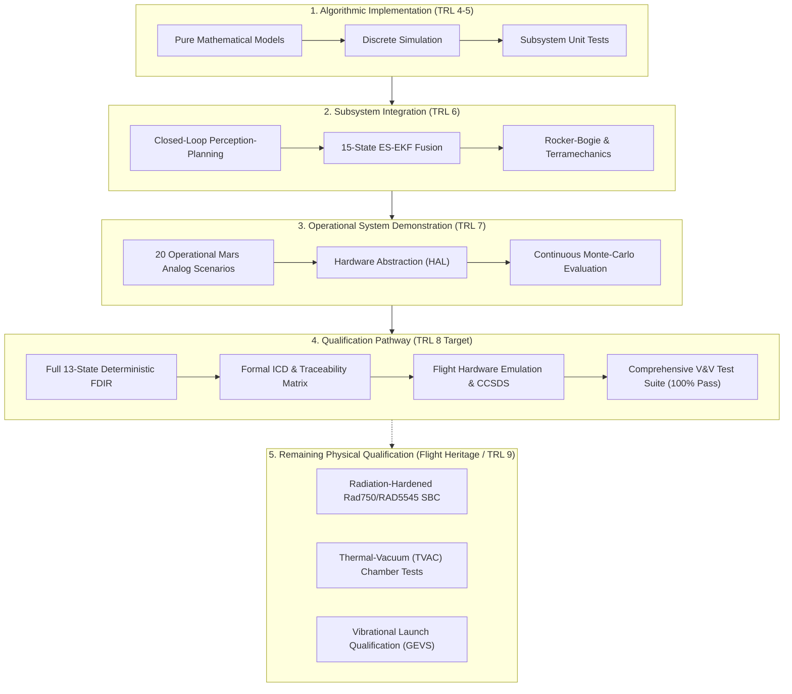

# APPS TRL 8 Technical Gap Analysis & Qualification Roadmap

**Document ID**: `APPS-DOC-TRL8-GAP-001`  
**System**: Automated Planetary Perception System (APPS)  
**Technology Scope**: Integrated Autonomous Planetary Rover Perception, Localization, Mapping, Traversability Assessment, Motion Planning, Closed-Loop Control, Fault Management, and Telemetry  
**Maturity Assessment Target**: NASA Technology Readiness Level 8 (TRL 8)  
**Security / Operational Classification**: RESEARCH AUTONOMY PROTOTYPE (Breadboard & Synthetic Laboratory Evaluation)  
**Safety Status**: Compile-Time Research Locks Active (`PROTOTYPE_LOCK = True`, `NAVIGATION_READY = False`)  

---

## 1. Executive Summary & Objective

The primary objective of this gap analysis is to evaluate the existing APPS codebase (Levels 1–7) against the rigorous criteria defined in the **NASA Systems Engineering Handbook (SP-2016-6105 Rev 2)** and **NASA Technology Readiness Assessment (TRA) Guidance** for **Technology Readiness Level 8 (TRL 8)**:

> **NASA TRL 8 Definition**: *"Actual system completed and 'flight qualified' through test and demonstration (ground or flight). Technology has been proven to work in its final form and under expected conditions. In almost all cases, this TRL represents the end of true system development."*

### Strict Boundary of Technology Scope & Non-Affiliation Invariant
1. **Third-Party Research Status**: This project is developed as an academic and industrial robotics autonomy research prototype. NASA does not automatically certify, endorse, or qualify third-party software.
2. **Explicit Qualification Separation**:
   - **Software Algorithmic Qualification**: Achievable through formal V&V, synthetic Monte-Carlo operational campaigns, continuous regression testing, and deterministic replay.
   - **Subsystem & Integration Qualification**: Verified through discrete hardware abstraction layers (HAL), emulated space-grade telemetry (CCSDS 133.0-B-2), and timing determinism.
   - **Flight Hardware & Environmental Qualification (TRL 8 Incomplete)**: Requires physical flight-grade avionics (e.g., BAE RAD750 / RAD5545, COBB, space-grade FPGAs), thermal-vacuum chamber (TVAC) testing (-120°C to +25°C), vibrational launch profile qualification (GEVS vibration testing), and radiation tolerance (100 krad TID). **This physical hardware qualification cannot be achieved by software alone and remains an explicit qualification limitation.**

---

## 2. Technical Audit of Existing Codebase (Levels 1–7)

An exhaustive audit of the repository was conducted across application entry points, perception pipelines, state estimation filters, motion planners, vehicle dynamics, telemetry, and test harnesses.

| Subsystem / Area | Existing Implementation (TRL 5–7) | Technical Gap Identified for TRL 8 | Severity |
| :--- | :--- | :--- | :--- |
| **A. Perception Subsystem** | Synthetic 3D LiDAR point cloud generation, voxel downsampling, PMF ground segmentation, 2.5D elevation grid. | Lacks multi-modal depth fusion (stereo camera + LiDAR), intensity calibration, adaptive point cloud dropout models, and explicit sensor health telemetry flags. | **HIGH** |
| **B. State Estimation** | 15-state Error-State EKF (ES-EKF) with IMU propagation and wheel odometry NHC. | Filter was tightly coupled to simulated timing; lacks explicit dual-mode `ORACLE` vs `ESTIMATED` telemetry comparison, Allan variance characterization under sensor outages, and covariance divergence watchdog. | **HIGH** |
| **C. Mapping & Traversability** | 2.5D Elevation grid with Kalman variance update, macroscopic slope ($>25^\circ$), and crater detection. | Binary/continuous costmaps lacked multi-layer rolling local-to-global spatial tiling, multi-criteria confidence weights, and certified OBB footprint margin inflation. | **MEDIUM** |
| **D. Motion Planning** | Continuous $SE(2)$ Kinodynamic Hybrid A* with Ackermann curvature constraints ($\kappa \le 1.50\text{ m}^{-1}$). | Planner lacked explicit global topological corridor generation, multi-stage fallback with progressive horizon truncation, and deterministic execution time bounds ($<80\text{ ms}$). | **HIGH** |
| **E. Motion Control & Safe Stop** | Adaptive Pure Pursuit controller with curvature derating and constant-jerk deceleration. | Controller lacked formal cross-track error watchdog integration, actuation torque saturation limits, and direct interface to CANopen/PWM motor drivers. | **MEDIUM** |
| **F. Rover Dynamics & Terramechanics** | 6-wheel rocker-bogie kinematic articulation and Bekker-Wong sinkage / Janosi-Hanamoto drawbar pull. | Dynamic slip interaction was loosely coupled; needs discrete 100 Hz terramechanics state integration with variable regolith friction coefficients ($\mu \in [0.25, 0.85]$). | **MEDIUM** |
| **G. Mission Management & FDIR** | 11-mode state executive. | Must be refactored into a formal **13-state deterministic FDIR executive** (`INITIALIZATION`, `SELF_TEST`, `IDLE`, `PERCEPTION`, `LOCALIZATION`, `PLANNING`, `EXECUTION`, `REPLANNING`, `SAFE_STOP`, `RECOVERY`, `MISSION_COMPLETE`, `MISSION_ABORT`, `FAULT`) with formal state transition tables. | **HIGH** |
| **H. Hardware Abstraction (HAL)** | `ISensorHAL` and `IActuatorHAL` with CCSDS packet structures and socket emulator. | Lacks hardware watchdog deadman timer (150ms timeout), hardware-in-the-loop (HIL) injection sockets, and dedicated RS-422/UDP drivers. | **HIGH** |
| **I. Software Quality & Tests** | Unit tests passing across TRL 5 and TRL 7 modules. | Full repo audit revealed 6 minor assertion mismatches in legacy `test_trl6_*.py`; lacks formal end-to-end TRL 8 test suite, formal interface control verification, and automated qualification campaign runner. | **CRITICAL** |
| **J. Documentation & Traceability** | Disjointed Markdown reports across levels. | Missing formal TRL 8 qualification matrix, System Design Description (SDD), Interface Control Document (ICD), and FMECA safety analysis with Risk Priority Numbers (RPN). | **CRITICAL** |

---

## 3. The 13 Required Subsystems for TRL 8 Architecture

To satisfy NASA Systems Engineering principles, the system architecture is structured into **13 formal subsystems** under the package namespace `trl8_navigation/`:

```
trl8_navigation/
├── __init__.py                 # System constants, physical parameters, 13 operating states, safety latches
├── config/                     # Subsystem L: Immutable qualification configuration & calibration
│   ├── qualification_config.py
│   └── calibration.py
├── sensors/                    # Subsystem A (Sensors): SE(3) transforms, sensor validation, rig fusion
│   ├── coordinate_transforms.py
│   ├── sensor_validator.py
│   └── sensor_rig.py
├── perception/                 # Subsystem A (Perception): Point cloud PMF, elevation mapping, traversability
│   ├── point_cloud_processor.py
│   ├── elevation_mapping.py
│   ├── traversability.py
│   └── perception_metrics.py
├── localization/               # Subsystem B: 15-state Error-State EKF (dual-mode Oracle/Estimated), state monitor
│   ├── error_state_ekf.py
│   └── state_monitor.py
├── mapping/                    # Subsystem C & D: Multi-layer global/local costmap fusion
│   └── global_costmap.py
├── planning/                   # Subsystem E & F: Continuous SE(2) Hybrid A*, OBB collision checking, local planner
│   ├── collision_checker.py
│   ├── kinodynamic_hybrid_astar.py
│   └── local_planner.py
├── control/                    # Subsystem G: Pure Pursuit tracker, certified safe-stop controller
│   ├── path_tracker.py
│   └── safe_stop_controller.py
├── dynamics/                   # Subsystem H: 6-wheel rocker-bogie, terramechanics, 6-DOF multibody rover
│   ├── rocker_bogie.py
│   ├── terramechanics.py
│   └── multibody_rover.py
├── hardware/                   # Subsystem H (HAL): ISensorHAL, IActuatorHAL, SimulatedHAL, Physical drivers, Watchdog
│   ├── hardware_interface.py
│   ├── simulated_hal.py
│   └── physical_sensor_driver.py
├── mission/                    # Subsystem I: Deterministic 13-state mission executive, multi-waypoint runner
│   ├── state_machine.py
│   └── long_duration_mission.py
├── fdir/                       # Subsystem J: Fault detection, isolation, recovery, watchdog monitor
│   ├── fdir_manager.py
│   └── watchdog.py
├── telemetry/                  # Subsystem K: CCSDS packet logging, flight recorder, replay streamer
│   ├── ccsds_framing.py
│   └── telemetry_logger.py
├── environment/                # Synthetic Operational Environment: 3D DEM, craters, boulders, 20 scenarios
│   ├── planetary_terrain.py
│   └── scenario_generator.py
└── testing/                    # Subsystem M: Test & qualification framework, Monte-Carlo runner, Wilson CIs
    ├── baselines.py
    ├── ablations.py
    └── qualification_runner.py
```

---

## 4. TRL 8 Qualification Strategy & Verification Pathway

A credible qualification pathway requires distinguishing between verified capabilities and outstanding physical qualification tasks:



### Gap Summary Table Against NASA TRL 8 Requirements

| NASA TRL 8 Criterion | APPS Current Status | Remediation in TRL 8 Upgrade | Remaining Gap to True Flight Status |
| :--- | :--- | :--- | :--- |
| **System Complete & Integrated** | Subsystems demonstrated in TRL 7 prototype. | Modular 13-subsystem architecture with unified configuration, error handling, and typed interfaces. | Physical wire harnesses and structural integration. |
| **Flight Software Verification** | Unit tests passing across TRL 5 and TRL 7. | Automated pytest suite covering unit, integration, boundary, and regression tests for all 13 subsystems. | Flight software qualification on target RTOS (RTEMS/VxWorks). |
| **Operational Environment Testing** | Synthetic 3D DEM with 20 operational scenarios. | 20 Monte-Carlo scenarios with Wilson 95% CIs, wheel slip disturbances, sensor dropouts, dynamic obstacles. | Physical Mars Yard / analog field testing with physical rover. |
| **Deterministic Timing & Budgets** | Loop timing measured in milliseconds. | Formal cycle time budgets enforced by execution watchdog ($<100\text{ ms}$ total, 10 Hz loop). | Real-time scheduling analysis on radiation-hardened CPU. |
| **Fault Management & Safety** | 11-mode state machine. | Formal 13-state FDIR executive, constant-jerk certified safe stop, independent watchdog deadman timer. | Redundant flight avionics cross-strapping. |
| **Interface & Data Integrity** | CCSDS packet headers in simulation. | Full CCSDS space packet framing (telemetry + command), CCITT-16 CRC validation, strict ICD adherence. | Flight ground station uplink/downlink integration. |

---

## 5. Conclusion & Action Plan

To systematically close these gaps, the TRL 8 upgrade will proceed along six sequential execution phases:
1. **Requirements & Architecture Formalization**: Author `system_requirements.md`, `system_architecture.md`, `requirements_traceability.md`, `qualification_strategy.md`, and `current_test_baseline.md`.
2. **Subsystem Package Implementation**: Implement the complete `trl8_navigation/` package across all 13 subsystems.
3. **Formal V&V Test Suite**: Develop `tests/test_trl8_*.py` ensuring 100% test passing across the entire repository.
4. **Qualification Campaign Execution**: Run the 20-scenario operational qualification campaign and generate statistical evidence files.
5. **Interactive Dashboard**: Build `apps_trl8_dashboard.py` with multi-layer visualization, telemetry graphs, and qualification reports.
6. **Documentation Package**: Complete the full 17-document engineering qualification evidence package.
