# APPS Verification and Validation (V&V) Plan — NASA TRL 5 Campaign

## 1. Scope & Objective

The objective of this Verification and Validation (V&V) plan is to establish a rigorous, repeatable testing and experimental benchmarking regime to evaluate the **Automated Planetary Perception System (APPS)** against the requirements defined in `docs/system_requirements.md`.

This plan specifies:
1. Environmental assumptions and simulation test configurations.
2. The 15 standardized planetary scenario classes.
3. Automated test execution and recording protocols.
4. Pass/fail acceptance criteria and statistical confidence estimation.
5. Baseline algorithms and ablation study specifications.

---

## 2. Test Configurations & Environmental Setups

Every test configuration is fully deterministic, instantiated from a formal configuration object or JSON scenario definition, and governed by an explicit pseudo-random number generator (PRNG) seed.

```mermaid
flowchart LR
    Config[Scenario Configuration File\nGeometry, Hazards, Noise, Seed] --> EnvSim[3D Planetary Environment Engine\nElevation, Craters, Rocks, Regolith]
    EnvSim --> Rig[Multi-Sensor Rig\nLiDAR, Depth, IMU, Odometry]
    Rig --> Pipeline[Perception & EKF Localization]
    Pipeline --> Planner[Kinodynamic Hybrid A* Planner]
    Planner --> Exec[Closed-Loop Motion Executor & FDIR]
    Exec --> Telemetry[Machine-Readable Telemetry Logger\nJSON & CSV Manifest]
    Telemetry --> Auditor[Automated V&V Acceptance Auditor\n15-Scenario Pass/Fail Analysis]
```

### Environmental Parameters:
- **Map Dimensions**: $60\text{ m} \times 60\text{ m}$ (grid resolution $0.20\text{ m/cell}$, $300 \times 300$ grid).
- **Gravity**: $g = 3.71\text{ m/s}^2$.
- **Rover Dimensions**: Length $1.20\text{ m}$, Width $0.90\text{ m}$, Height $0.80\text{ m}$, Wheel Radius $r = 0.15\text{ m}$, Mass $m = 185.0\text{ kg}$.
- **Kinodynamic Limits**: $v_{\max} = 0.50\text{ m/s}$, $|a_{\max}| = 0.20\text{ m/s}^2$, $|\kappa_{\max}| = 1.50\text{ m}^{-1}$ ($\rho_{\min} = 0.67\text{ m}$).

---

## 3. The 15 Standardized Scenario Classes

The validation campaign executes trials across 15 distinct operational challenge classes, testing both nominal performance and extreme boundary conditions:

| Scenario Class ID | Scenario Name | Primary Environmental / Failure Conditions | Key Stress Objective |
|:---|:---|:---|:---|
| **SC-01** | `flat_baseline` | Flat terrain, zero obstacles, nominal friction | Establish baseline path efficiency, kinematic smoothness, and dead-reckoning accuracy. |
| **SC-02** | `moderate_slopes` | Continuous undulations ($10^\circ - 15^\circ$), mild rock distribution | Test slope cost calculation, gravity load redistribution, and speed derating. |
| **SC-03** | `steep_slopes` | Steep ridges ($20^\circ - 25^\circ$), near operational pitch/roll limits | Verify planner avoids non-traversable slope boundaries and prevents tip-over risk. |
| **SC-04** | `dense_obstacle_field`| Rock coverage $> 20\%$, boulders $0.20\text{ m} - 1.5\text{ m}$ diameter | Evaluate obstacle extraction, footprint clearance checks, and maze-like pathfinding. |
| **SC-05** | `narrow_passages` | Chokepoints and boulder corridors ($1.4\text{ m} - 1.8\text{ m}$ wide) | Test chassis swept polygon collision checking with narrow clearance margins ($0.3\text{ m}$). |
| **SC-06** | `crater_avoidance` | Deep impact crater ($4.0\text{ m}$ diameter, $1.2\text{ m}$ depth) with steep rims | Verify negative obstacle detection via ray shadow casting and drop-out detection. |
| **SC-07** | `sensor_noise` | $3\times$ nominal LiDAR range noise ($\sigma_r = 0.09\text{ m}$) & camera noise | Measure traversability cost-map resilience and height variance uncertainty pooling. |
| **SC-08** | `sensor_dropout` | $50\%$ LiDAR beam dropouts & transient camera frame drops | Verify multi-frame temporal map fusion and frozen-frame watchdog safety halt. |
| **SC-09** | `localization_drift` | Degraded IMU ($15^\circ/\text{hr}$ drift) and noisy wheel encoders | Test Error-State EKF drift bounds and map-relative trajectory tracking error. |
| **SC-10** | `wheel_slip_disturbance` | Low-cohesion loose drift sand (slip ratio $s \ge 0.40$) | Test slip entrapment watchdog triggering and drawbar pull traction degradation. |
| **SC-11** | `unexpected_obstacles` | Dynamic pop-up boulder appearing mid-traverse within $3.0\text{ m}$ | Verify real-time sensor update, dynamic replanning trigger, and collision avoidance. |
| **SC-12** | `completely_blocked` | Impassable rock wall blocking all routes to goal | **Crucial safety test**: Verify rover comes to a safe stop; **must report clean failure, NEVER false success**. |
| **SC-13** | `low_traction_regolith` | Low-friction surface ($\mu = 0.25$, reduced shear strength) | Verify velocity derating and conservative braking profile under low drawbar pull. |
| **SC-14** | `environmental_replan` | Route obstructed midway, alternative longer detour available | Evaluate closed-loop replanning latency, detour execution, and goal reachability. |
| **SC-15** | `critical_fault_safestop`| Induced sensor failure / EKF divergence mid-traverse | Verify immediate transition to `SAFE_STOP` and certified deceleration profile to complete rest. |

---

## 4. Acceptance Criteria & Automated Pass/Fail Conditions

A trial is classified as an automated **PASS** if and only if all following conditions are satisfied:
1. **Collision Freedom**: Total obstacle collisions $= 0$. Any collision immediately causes a catastrophic failure (**FAIL**).
2. **Goal Arrival (Nominal/Traversable Scenarios)**: Euclidean distance to goal $\|p_{\mathrm{end}} - p_{\mathrm{goal}}\| \le 0.50\text{ m}$.
3. **Safe Stop on Blocked/Fault Scenarios**: For SC-12 (`completely_blocked`) and SC-15 (`critical_fault`), the vehicle must halt gracefully in state `SAFE_STOP` with distance to nearest obstacle $\ge 0.30\text{ m}$, cleanly reporting `GOAL_UNREACHABLE` or `FAULT_TRIPPED` rather than false success.
4. **Trajectory Error Limit**: In scenarios with viable localization, Absolute Trajectory Error (ATE RMSE) $\le 0.60\text{ m}$.
5. **Planning Latency Budget**: Mean replanning latency $\le 150\text{ ms}$; worst-case latency $\le 300\text{ ms}$.

### Statistical Confidence:
For each scenario class, $N \ge 5$ deterministic random seeds are evaluated (total $\ge 75$ runs in baseline campaign). The Wilson score interval (95% confidence level) is computed for success rates:
$$w = \frac{p + \frac{z^2}{2N} \pm z \sqrt{\frac{p(1-p)}{N} + \frac{z^2}{4N^2}}}{1 + \frac{z^2}{N}}$$

---

## 5. Comparative Baselines & Ablation Studies

### Baselines:
1. **Baseline 1 (Straight-Line Waypoint Follower)**: Direct line-of-sight tracking ignoring terrain costs.
2. **Baseline 2 (Standard 2D Grid $A^*$)**: Unsmoothed cell-grid $A^*$ pathfinding ignoring vehicle turning constraints and chassis footprint.
3. **Baseline 3 (Terrain-Cost $A^*$)**: 2D grid $A^*$ incorporating slope cost, but lacking continuous kinodynamic curvature and slip constraints.
4. **Proposed (Kinodynamic Hybrid $A^*$ + EKF)**: Complete perception-informed kinodynamic navigation engine.

### Ablation Matrix:
- **Ablation A**: Disable terrain slope cost (treat all slopes $< 25^\circ$ as uniform cost).
- **Ablation B**: Disable dynamic obstacle map updates (rely only on initial prior map).
- **Ablation C**: Disable closed-loop replanning (execute initial plan open-loop).
- **Ablation D**: Disable sensor fusion (use raw noisy wheel odometry alone without IMU).
- **Ablation E**: Replace EKF state estimator with simulator ground-truth oracle.
